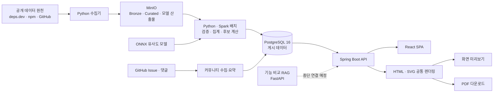

# Pickage

## 한 줄 소개

Pickage는 npm 패키지 하나를 입력하면 의미 유사도와 구조적 자격 관문을 이용해 비교할 후보를 찾고, 사용자가 고른 최대 3개 패키지의 직접 의존 선언 수·Downloads·최신 버전 분포·유지/유입/이탈을 한 보고서에서 비교하도록 돕는 패키지 분석 서비스다.

> 이 문서는 **2026-09-20 `develop` 브랜치 기준의 개발 중간 기록**이다. 프로젝트는 아직 진행 중이며 완료·수상 사실은 없다. SSAFY 규정상 소스코드는 공개할 수 없으므로 코드 원문 대신 문제 정의, 사용자 흐름, 구조와 의사결정, 검증 결과를 서술한다. 기획 목표와 실제 구현 상태가 다르면 둘을 구분해 적었다.

## 기본 정보

| 항목 | 내용 |
| --- | --- |
| 저장소 | 비공개 사내 GitLab(SSAFY 소스코드 반출·공개 금지) |
| 기간 | 2026-08-20 ~ 진행 중 |
| 형태 | SSAFY 15기 빅데이터 분산 트랙 공통 프로젝트, 6인 팀 |
| 역할 | 팀장·PM·발표, 기획-구현 정합성 관리, 백엔드·프런트엔드 개발 공백 보완 |
| 팀 구성 | PM·AI·백엔드·풀스택 역할을 포함한 6인 |
| 주요 기술 | Java 21, Spring Boot 4, React 19, TypeScript, Vite 8, TanStack Query, Python, FastAPI, ONNX Runtime, Apache Spark 3.5, PostgreSQL 16, MinIO, Docker Compose, GitLab CI |

## 문제 정의

npm 패키지를 도입하거나 교체하려는 개발자는 보통 검색 결과, 다운로드 통계, 의존 관계, 버전 분포, GitHub 이슈를 서로 다른 곳에서 확인한다. 이때 이름이나 설명이 비슷한 패키지가 실제 대안이라는 보장은 없고, Downloads 같은 인기 지표만 앞세우면 목적이 다른 대형 패키지가 후보를 잠식할 수 있다. 서로 다른 시점의 수치를 한 화면에 섞으면 시계열 변화와 최신 스냅샷도 쉽게 혼동한다.

Pickage는 이 문제를 다음 흐름으로 묶는다.

1. 패키지명을 자동완성하거나 직접 입력하고 실제 존재 여부를 확인한다.
2. 의미 검색으로 넓은 후보 풀을 찾은 뒤 같은 제품군·노후·실체 미달 후보를 구조적 관문으로 제외한다. dependent 교집합을 이용한 보완재 관문은 후속 구현 범위다.
3. 사용자가 기준 패키지를 포함해 최대 3개 비교 대상을 직접 확정한다.
4. 직접 의존 선언 수와 Downloads의 시간 변화, 최신 Version Share, 유지·유입·이탈을 함께 본다.
5. 기준 패키지의 GitHub 핵심 이슈와 실제 댓글에 근거한 커뮤니티 요약을 확인한다.
6. 준비된 결과를 화면과 같은 의미의 PDF로 내보낸다.

서비스가 대신 결정하지 않는 것도 중요하다. 후보 순위는 기술 품질 순위가 아니며, Pickage는 “최고의 패키지”를 고르거나 실제 설치량을 추정하지 않는다. 관측 가능한 공개 데이터와 판정 근거를 정리하고 최종 판단은 사용자에게 남긴다.

## 현재 구현 범위

### 핵심 흐름

- 패키지 접두사 자동완성, 자유 입력, 서버 존재 검증
- 의미 유사도와 현재 구현된 구조적 관문(plugin/adapter, 같은 제품군, archived 저장소 등)을 통과한 비교 후보 조회
- 기준 패키지를 포함한 최대 3개 비교 대상 선택
- 직접 의존 선언 수 추이와 실제값·변화율 전환, major 다중 선택, 기간 프리셋
- 주간 Downloads 추이와 규모 차이를 보완하는 축 표현
- 최신 DB Snapshot 기준 major별 Version Share
- 동일 dependent의 Snapshot 간 유지·채택 유입·이탈·미관측 분석과 이탈 사유 조회

### 확장 기능의 실제 상태

| 기능 | 2026-09-20 상태 | 확인 근거 |
| --- | --- | --- |
| GitHub 커뮤니티 | 화면·API·저장소 검증·Issue/댓글 수집·요약·스냅샷 저장까지 구현 | 프런트 `community` 탭과 백엔드 `community` 도메인 존재 |
| PDF | 생태계 그래프, Version Share, 유지/유입/이탈, 선택 시 커뮤니티 구역을 포함하는 미리보기·다운로드 구현 | PDF 전용 Controller·Service·HTML/SVG 렌더러와 화면 모달 존재 |
| 기능 비교 RAG | README 인계 파일을 청킹·검색·생성·검증하는 FastAPI `/compare` 구현 | `ai/rag`의 HTTP 서버와 단위 테스트 존재 |
| 기능 비교 화면 | 일부 패키지 조합의 POC 표본만 표시 | 화면이 아직 `sample.ts`에 의존하며 일반 조합은 준비되지 않음으로 표시 |

따라서 “기능 비교가 완성됐다”고 쓰지는 않는다. RAG 실행 계층은 생겼지만 모든 패키지 조합을 화면까지 연결하는 종단 흐름은 아직 완성되지 않았다. 반면 9월 15일 문서에서 화면 미구현이었던 GitHub 커뮤니티와 단순 뼈대였던 PDF는 이후 실제 구현이 크게 진행됐다.

## 시스템 구조

운영은 역할이 다른 두 노드로 나뉜다.

- **data 노드**: MinIO, MLflow, Spark master/worker, 유사도 배치와 수집 작업
- **app 노드**: PostgreSQL, Spring Boot API, React 정적 파일을 서빙하는 nginx, 기능 비교 RAG API, 유사도 결과 로더

브라우저가 접근하는 공개 진입점은 nginx의 HTTP/HTTPS뿐이고 API와 PostgreSQL은 외부에 직접 노출하지 않는다. 로컬은 한 컨테이너의 Spark local mode를 쓰지만 운영은 두 호스트에 master와 worker가 나뉘므로, 크로스 호스트 네트워킹과 메모리 상한은 운영에서 별도로 검증해야 했다.

## 데이터가 보고서가 되기까지

| 단계 | 처리 내용 | 결과 |
| --- | --- | --- |
| 수집 | deps.dev BigQuery, npm Downloads·Registry, ecosyste.ms, GitHub 공개 데이터를 원천별 수집기로 가져옴 | 압축 JSONL·Parquet 원본 |
| 원본 보존 | 검증한 원본을 변경 불가능한 Bronze 단위로 MinIO에 게시 | 재처리 가능한 원천과 manifest |
| 정제·집계 | Snapshot 기준 정규화, 다운로드 구간 합계, 직접 의존 수, 버전 분포, dependent 전이 계산 | Curated Parquet |
| 게시 | staging 적재와 품질 검증을 거쳐 PostgreSQL의 현재 데이터셋 포인터를 전환 | API가 읽는 일관된 결과 한 벌 |
| 후보 생성 | 패키지 설명·keywords를 ONNX로 임베딩하고 top-K 의미 검색 후 구조적 관문 적용 | `similar_package` 결과 |
| 서빙 | Spring Boot가 사전 계산 결과를 조회하고 React Query가 요청 상태를 관리 | 비교 보고서와 PDF |

이 구조에서 요청 시점에 무거운 임베딩이나 전 생태계 집계를 다시 수행하지 않는다. 배치가 계산한 결과를 PostgreSQL에 게시하고 웹 요청은 읽기에 집중해 응답 시간과 운영 복잡도를 제어했다.

## 주요 기술과 선택 이유

| 기술 | 사용한 이유 |
| --- | --- |
| PostgreSQL + Flyway | 서비스 조회 모델과 적재 이력을 관계형으로 관리하고, 로컬·운영이 같은 SQL 마이그레이션을 사용하도록 스키마 정본을 하나로 유지 |
| MinIO + Parquet | 대용량 원본·Curated·모델 산출물을 DB와 분리하고, 검증한 원천에서 다시 계산할 수 있도록 보존 |
| Spark + Python | Snapshot 간 대규모 의존 관계와 파생 데이터셋을 배치로 계산하고 수집·검증 도구를 빠르게 개발 |
| ONNX Runtime | 학습 환경과 분리된 CPU 운영 노드에서 임베딩 모델을 실행하고 PyTorch 대비 결과 일치 여부를 검증 가능하게 구성 |
| Spring Boot | 패키지·커뮤니티·PDF·운영 상태 API를 한 서버에서 제공하고 Bean Validation, Flyway, Actuator를 운영 계약에 포함 |
| React + TanStack Query | 생태계·기능 비교·커뮤니티 탭의 서버 상태와 재시도 흐름을 분리하고, 비활성 탭까지 lazy loading |
| 직접 만든 SVG 차트 | 라이브러리 종속 표현과 분리해 화면과 PDF가 같은 기하 계산 규칙을 재사용 |
| FastAPI RAG 서비스 | 기능 비교의 청킹·검색·생성·검증 파이프라인을 Java API와 독립적으로 개발·배포 |
| Docker Compose + GitLab CI | 로컬, app 노드, data 노드의 실행 구성을 명시하고 프런트·백엔드·AI/RAG 검증과 배포를 자동화 |

Redis는 초기 기획에 있었지만 현재 구조에서는 사용하지 않는다. 대부분의 화면이 사전 집계 조회라 별도 캐시 계층의 효익이 명확하지 않았고, 사용하지 않는 Redis 의존성이 Actuator 상태를 계속 `DOWN`으로 만드는 문제도 있어 클래스패스에서 제외했다.

## 핵심 설계 판단

### 후보 순위와 기술 우열을 분리

유사 후보는 생성형 AI가 이름을 만들거나 순서를 보정하지 않는다. 패키지의 `description + keywords`를 임베딩해 의미 후보를 찾고, plugin/adapter/preset/loader, 같은 제품군, archived 저장소처럼 대안으로 부적합한 후보를 점수 감점이 아닌 통과/탈락 관문으로 제거한다. 관문 통과 뒤에는 cosine 유사도로만 정렬한다. dependent 교집합으로 보완재를 거르는 규칙은 설계에는 있지만 의존 그래프가 더 필요해 현재 코드에서는 TODO로 남아 있다.

Downloads나 dependents 같은 인기도는 후보의 “생존 여부”를 확인하는 보조 기준일 수는 있지만 의미 관련성 점수에 더하지 않는다. 인기 신호가 강한 전혀 다른 목적의 패키지가 상위 후보를 차지하는 것을 막기 위한 결정이다.

### `0`과 `모름`을 다른 상태로 관리

시계열 point가 없거나 아직 계산하지 않은 값을 `0`으로 채우면 “사용자가 없다”는 거짓 결론이 생긴다. 그래서 게시 데이터의 `COMPLETE`, `NO_DATA`, `NOT_COMPUTED`, `OUT_OF_SCOPE`와 화면 요청의 `loading`, `success`, `empty`, `error`를 다른 축으로 관리한다. PDF도 같은 계약을 따라 자료 없음은 대시와 사유로 표시한다.

### 화면과 PDF의 의미를 하나로 유지

PDF 미리보기와 다운로드를 따로 그리면 제목, 수치, 그래프가 쉽게 갈라진다. 서버에서 하나의 XHTML과 SVG 그래프를 만들고, 같은 HTML을 브라우저 미리보기에 사용하면서 PDF 변환에도 재사용했다. 한글 폰트를 문서에 포함하고 외부 문자열은 모두 escape해 글자 누락, XML 파싱 실패, 스크립트 삽입을 함께 방지했다.

### 근거 없는 AI 결과를 통과시키지 않기

기능 비교 RAG는 README를 문단 경계로 청킹하고, 검색된 근거 ID가 실제로 존재하는지와 요청한 패키지·버전에 속하는지를 검증한다. 판정값도 허용 목록과 근거 충족 조건을 통과해야 한다. 커뮤니티 요약 역시 모델이 보낸 사용자 역할이나 출처를 신뢰하지 않고 수집한 GitHub 원문에서 다시 복원한다.

## 대표 문제 해결

### 1. 커뮤니티 대용량 요약을 Map-Reduce에서 하이라이트 방식으로 전환

댓글이 많은 GitHub 이슈를 모두 설명하기 위해 처음에는 입력을 여러 번 Map하고 다시 Reduce하는 구조를 구현했다. 그러나 실제 패키지 이슈로 반복 측정하자 한 이슈에 최대 6회의 모델 호출과 약 2만 6천 토큰이 들었고, 약 30초가 걸리면서 검증 실패도 자주 발생했다. 시연형 서비스에 맞지 않는 비용이었다.

구현을 유지하는 대신 목표를 다시 정의했다. 전체 논의를 재구성하지 않고 “반응이 가장 많은 댓글 → 이후 첫 maintainer 답글 → 그 뒤 첫 댓글”을 최대 3개까지 골라 한 번만 요약하도록 바꿨다. 불필요해진 Map-Reduce 코드는 삭제했고, 댓글 수집은 병렬화하되 GitHub rate limit 예외가 비동기 래퍼에 가려지지 않도록 보정했다.

실측 결과는 다음과 같았다.

| 방식 | 실제 측정 |
| --- | --- |
| Map-Reduce + 기존 모델 | vite 이슈 약 29.5초, 검증 실패 다수 |
| 하이라이트 단일 호출 | express 약 6.2초, 이후 prompt 보정한 express·rollup 약 8.7초, 검증 실패 0건 |

이 경험으로 “정보를 최대한 많이 생성하는 것”보다 사용자가 검증 가능한 핵심 논의를 제한된 시간 안에 안정적으로 보는 것이 제품 가치에 더 가깝다는 점을 배웠다.

### 2. 229개 파티션의 서비스 DB를 완료 작업을 버리지 않고 이관

로컬 PostgreSQL의 패키지·버전·Snapshot 데이터를 운영으로 옮길 때 가장 큰 테이블은 날짜별 229개 파티션으로 구성됐다. 초기 복원에서는 외래키 검증과 날짜별 인덱스 생성이 잠금을 두고 충돌했고, 전체 과정이 길어졌다.

이미 끝난 COPY를 다시 하지 않도록 빈 참조 DB와 실제 객체 정의를 비교해 완료 객체를 건너뛰는 재개 도구를 만들었다. 첫·중간·마지막 파티션의 실행 계획에서 양쪽 Index Only Scan, 정렬 없음, Heap Fetches 0을 확인한 뒤에만 전체 외래키 검증으로 진행했다. 개선한 재개 실행은 약 3시간 17분, 최초 시작부터 최종 복원까지는 약 9시간 30분이 걸렸다. 최종 서비스 DB 이름 전환 절차는 12.649초였지만, 이 값을 정확한 외부 다운타임으로 과장하지 않고 별도로 기록했다.

핵심은 실패한 대량 작업을 처음부터 반복하지 않는 재개 가능성과, DB 전환 성공을 최신 API 배포 성공과 분리해 검증한 점이다.

### 3. 운영 모델의 메모리 가정을 실측으로 수정

현재 운영 유사도 모델은 `BAAI/bge-small-en-v1.5` 기반 LoRA 모델을 ONNX로 변환해 CPU에서 실행한다. 약 2만 9천 패키지를 임베딩하고 top-30 검색과 구조적 관문까지 처리한 첫 운영 배치는 1,884.8초가 걸렸고 메모리 최고점은 5.236 GiB였다.

컨테이너 상한 2 GiB와 4 GiB에서는 OOM이 발생했고 8 GiB에서 완주했다. 문서상의 예상치가 아니라 이 실측을 기준으로 메모리 상한을 조정하고, Spark ETL과 AI 배치가 같은 data 노드 자원을 동시에 점유하지 않도록 실행 시간 분리를 운영 과제로 남겼다. 모델 정확도와 별개로 “운영에서 끝까지 실행되는가”도 모델 계약의 일부라는 사실을 확인한 사례다.

## 품질과 운영 기준

- 프런트엔드는 TypeScript 검사, ESLint, Prettier, Vitest를 CI에서 실행한다.
- 백엔드는 DB가 필요 없는 단위 테스트와 실제 PostgreSQL이 필요한 통합 테스트를 Gradle source set으로 분리했다. 통합 테스트가 0개일 때 Gradle이 조용히 `NO-SOURCE`로 통과하지 않도록 별도 검사도 둔다.
- AI 유사도 배치와 RAG는 Python 단위 테스트를 별도로 운영한다.
- 2026-09-20 기준 저장소에는 탐색 기준으로 프런트 10개, 백엔드 61개, AI 9개, 파이프라인 112개 등 **테스트 파일 192개**가 추적돼 있다. 이는 파일 수이며 테스트 케이스 수나 모두 통과했다는 주장과는 구분한다.
- 운영 배포는 app/data 노드별 Compose를 분리하고, 커밋 SHA 이미지 태그·health check·롤백 절차를 문서화했다. 로컬 리허설에서는 TLS 종단, SPA 딥링크, Swagger, Actuator까지 확인한다.
- 주간 수집 상태는 서로 다른 노드의 DB 포트를 열지 않고 MinIO 객체로 전달한다.

## 프로젝트 규모와 기여

2026-09-20 `develop`의 Git 이력을 세 계정명(`오세진`, `Sejin Oh`, `Sejin_oh`)으로 합산했다. 커밋 수는 작업량의 보조 지표일 뿐 코드 품질이나 기여 가치를 그대로 뜻하지 않는다.

| 지표 | 값 |
| --- | ---: |
| 전체 커밋 | 868건 |
| merge 커밋 | 237건 |
| 본인 커밋 | 388건, 약 44.7% |
| 본인 merge | 129건, 약 54.4% |
| 본인 커밋에서 변경된 파일 경로의 상위 영역 누계 | `docs` 1,089회, `backend` 424회, `frontend` 159회 |
| 본인 커밋 제목에 연결된 고유 Jira 이슈 | 60개 |

### 내가 작업한 것

- 팀장으로서 서비스 범위, 사용자 흐름, 기획-구현 차이를 주기적으로 코드와 대조하고 현행 기획 세트를 갱신했다.
- 브랜치·커밋 규칙, Jira 분류, MR 템플릿, 환경 차이를 `AGENTS.md`에 정리하고 Git hook과 브랜치 생성 도구로 반복 실수를 줄였다.
- 커뮤니티 백엔드의 저장소 검증, Issue/댓글 제한 수집, Snapshot 저장·복원·TTL, 갱신 오케스트레이션, GMS 요약과 실패 정책을 단계별로 구현·검수했다.
- 대용량 커뮤니티 요약의 실패를 재현하고 Map-Reduce까지 구현한 뒤, 실사용 시간과 비용을 근거로 하이라이트 단일 호출 방식으로 전환했다.
- GitHub 커뮤니티 탭, 보고서 기간·차트 표현, 유지/유입/이탈 패널, 소개 화면과 패키지 자동완성 등 프런트 공백을 보완했다.
- 화면과 같은 데이터 계약을 쓰는 PDF 미리보기·다운로드, SVG 그래프, 한글 폰트, 커뮤니티 구역을 구현했다.
- 운영 유사도 모델의 실제 버전·학습 조건·recall·메모리 사용량을 GPU 서버, MinIO, 첫 운영 배치 결과와 대조해 문서 계약을 바로잡았다.
- 9월 15일 이후에만 173개 커밋을 추가하며 문서 중심 역할에서 백엔드·프런트엔드 구현까지 범위를 넓혔다.

## 배운 점

### 사전 계산 시스템에서는 게시 계약이 기능만큼 중요하다

수집, 변환, 모델 추론, DB 적재가 서로 다른 시점과 노드에서 실행되므로 “파일이 생겼다”만으로는 서비스 가능한 상태가 아니다. 입력 manifest, 실행 상태, 품질 검사, 현재 결과 포인터를 함께 기록해야 어떤 결과가 화면에 노출됐는지 재현할 수 있었다.

### 결측과 0을 구분해야 데이터 제품이 정직해진다

없는 point를 0으로 채우거나 미계산 상태를 빈 화면으로 숨기면 그래프는 그럴듯하지만 잘못된 결론을 만든다. API, 화면, PDF가 같은 상태 의미를 공유하도록 계약을 먼저 정하는 것이 차트 구현보다 중요했다.

### AI 기능은 모델 호출보다 입력 선택과 검증이 더 큰 품질 레버였다

긴 문맥을 모두 요약하는 구조보다 대표 댓글을 잘 고르는 방식이 더 빠르고 안정적이었다. 근거 ID·사용자 역할·허용 판정값을 코드로 다시 검증하면서, 프롬프트를 신뢰 경계로 사용해서는 안 된다는 점도 확인했다.

### 문서는 현재 구현을 따라가야 하고, 구현도 문서의 결정을 추적할 수 있어야 한다

프로젝트가 빠르게 변하면서 9월 15일에는 “미구현”이던 기능이 며칠 뒤 실제 코드가 됐다. 날짜별 문서 세트를 history로 보존하고 현행 문서에서 코드·Jira·실측 근거를 연결한 방식은 오래된 기획을 현재 사실로 오해하는 문제를 줄였다.

## 어려웠던 점과 해결

- **기획과 코드의 속도 차이**: develop의 커밋을 기준일 이후 전수 대조해 “문서만 있는 기능”, “코드가 있는 기능”, “화면까지 연결된 기능”을 나눴다.
- **운영과 로컬 환경 차이**: MinIO 버전, nginx TLS 종단, Spark 배치 구조, 컨테이너 swap 정책을 차이 표로 관리하고 운영에서만 생기는 문제의 우선 점검표로 사용했다.
- **대규모 작업 실패 비용**: 수집·DB 복원·AI 배치에 manifest, checkpoint, 포인터, 재개 도구를 두어 완료한 구간을 버리지 않도록 했다.
- **다직군 협업에서의 추적성**: Jira 키를 브랜치와 커밋 제목에 연결하고, MR 본문·검증 기록·worklog가 같은 이슈를 가리키도록 규칙화했다.

## 남은 과제

- 기능 비교 RAG 결과를 백엔드 run API와 일반 패키지 조합의 화면에 종단 연결
- 후보 관문의 보완재 판정과 평가셋 노후화 문제를 같은 조건의 반복 측정으로 검증
- 운영 모델·코퍼스·평가 bundle의 저장 경로와 manifest 계약 통일
- Spark ETL, 유사도 배치, 주간 수집의 data 노드 메모리·시간표 충돌 해소
- 커뮤니티 요약의 최종 대용량 표본과 운영 quota 재검증
- 실제 서비스 화면 캡처, 최종 성과, 사용자 피드백, 프로젝트 종료 회고 추가

## 비고

- 소스코드 반출·공개 금지 규정 때문에 코드 원문과 비공개 저장소 링크는 싣지 않았다.
- 수치와 구현 상태는 2026-09-20의 로컬 `develop` 이력과 저장소 파일을 기준으로 다시 계산했다.
- 프로젝트 종료 후 기간·완료 범위·최종 성과를 다시 갱신할 예정이다.
