# 씬크루 (SceneCrew)

**첫 곡 직전 메인 마이크에서 소리가 끊기면, 총괄은 어느 장비를 누가 가져올지 정해야 합니다.** 예비 마이크의 전원이 켜져 있어도 다른 팀이 사용할 시간이면 교체가 어렵습니다. 단체 채팅에 지시를 올려도 담당자가 읽었는지, 장비를 실제로 건넸는지는 따로 확인해야 합니다.

씬크루는 콘서트 계획서, 현장 팀원의 보고, 장비와 객석의 관측값을 한 공연의 업무에 연결한 웹·Android 서비스입니다. 총괄은 대응안을 검토해 업무를 변경하고, 팀원은 앱에서 지시를 확인한 뒤 수행 결과를 남깁니다.

| 항목 | 내용 |
| --- | --- |
| 프로젝트 | SSAFY 15기 자율 프로젝트, 6인 팀, 2026년 10월 13일 개발 기록 시작, 11월 18일 대회 시연 완료 |
| 내 역할 | PM·기획, 웹·Android 공통 기반과 API 연동, 무선 마이크 상태 수집기, 장비 상태·복구 백엔드 개발 |
| 팀 협업 | UI/UX, 인증·채팅·알림, 계획·변경 승인, AI 모델·데이터, 인프라·배포를 담당한 팀원들과 화면과 데이터의 기준을 맞췄습니다. |
| 주요 기술 | React·TypeScript·Capacitor Android, Java·Spring Boot, PostgreSQL·Redis, Python·FastAPI·LangGraph, Docker Compose |
| 회고 기준 | 11월 17일까지 통합된 개발 이력, 날짜별 시험·배포 기록, 11월 18일 현장 시연. 대표 화면은 통합 소스로 로컬 재현했고, 11월 4일 데모 화면은 접어서 보관했습니다. |

## 운영계획서에서 현장 조치까지

| 장면 | 사용자가 보고 결정하는 것 |
| --- | --- |
| 공연 준비 | 총괄이 운영계획서 PDF를 올리면 공연 정보와 일정표에서 초안을 만듭니다. 장비 목록과 평면도가 있으면 해당 입력 화면에 채우고, 총괄이 빠진 조건을 바로잡아 공개합니다. 직무 그룹에 참여한 팀원에게 최초 미배정 업무를 연결합니다. |
| 마이크 이상 보고 | 현장 노트북이 무선 수신기의 관측값을 전달합니다. 팀원은 무대에서 들은 현상을 앱에 말하고, 전사문에 장비명이 맞는지 고친 뒤 보고합니다. 총괄은 누가 무엇을 들었는지와 장비가 마지막으로 보낸 상태를 함께 봅니다. |
| 교체와 업무 변경 | 총괄은 교체할 장비의 예약 시간과 교체 업무를 맡을 사람을 확인합니다. 같은 시각에 다른 변경이 먼저 승인됐다면 최신 상태로 다시 미리 봅니다. 승인한 업무는 담당자 앱에 표시되고, 지시 확인과 실제 인수·설치는 별도로 기록합니다. |
| 관객 안전 | 안전 지도에서 카메라가 비추는 구역의 추정 인원, 촬영 시각, 관측 품질을 봅니다. A구역에 지원이 필요하면 B구역에 남을 최소 인원과 후보자의 기존 업무를 확인하고 총괄이 지원안을 승인합니다. |
| 공연 마감 | 총괄이 공연을 종료하고 운영 요약을 한 번 생성해 복사하거나 로컬에 저장할 수 있도록 구현했습니다. 서버에는 요약 생성 시도를 기록하고 요약문 원문은 보관하지 않는 설계를 적용했습니다. |

## 11월 18일 대회에서 보여준 장면

1. **계획서 입력.** 총괄 웹에서 공연계획서 PDF를 올려 추출이 시작되는 화면을 보여줬습니다. 이어서 미리 생성해 둔 운영 중 행사로 전환했습니다.
2. **메인 마이크 중단과 복구.** 발표 중 제가 메인 마이크 전원을 껐습니다. 장비 운영팀원이 무대의 무음을 음성으로 보고했고, 총괄은 접수된 보고에서 보조 마이크 교체 업무와 담당자를 검토해 승인했습니다. 담당자가 앱에서 지시를 확인하고 보조 마이크를 건넨 뒤 제가 발표를 이어갔습니다.
3. **객석 A구역 인력 지원.** 관객이 무대 앞 A구역으로 이동하자 총괄은 현장 보고와 카메라의 촬영 시각, A·B구역 추정 밀집도를 확인했습니다. B구역에 남을 인원을 고려해 지원 업무를 승인했고, 안전요원이 자기 앱에서 확인한 뒤 A구역으로 이동했습니다.

시연 시나리오는 모두 수행했습니다. 다만 위 기록은 당일 수행한 행동을 정리한 것이며, 아래 캡처는 같은 기능을 설명하기 위해 가상 공연으로 다시 연 화면입니다. 마이크 교체에 걸린 시간, 시연 중 분석 지연과 인원 추정 정확도는 따로 계측하지 않았습니다.

## 문제 정의

### 처음에는 교사와 학생 운영진을 생각했습니다

운동회를 준비하는 교사, MT 운영진, 발표회를 준비하는 팀처럼 운영이 본업이 아닌 사람들은 계획서는 만들어도 **당일 현장에서 무슨 일이 생겼을 때 누구를 어디로 보내야 하는지** 판단하기 어렵습니다. 업무가 엑셀·단톡방·구두 지시로 흩어져 있어서, 변경이 생기면 "누가 알고 있고, 누가 실제로 움직였는지"를 확인할 방법이 없습니다.

### 11월 2일, 콘서트 현장으로 범위를 좁혔습니다

대회 시연을 준비하면서, 범용 행사에서 **콘서트 운영**으로 대상을 좁히고 네 가지를 더했습니다.

| 추가한 것 | 풀려는 문제 |
| --- | --- |
| 장비 복구 대안 계산 | 메인 마이크가 꺼졌을 때 예비 장비·담당자·이동 시간·예약 충돌을 따져 실제로 가능한 복구안을 고르기 |
| 고정 카메라 기반 구역별 안전 지원 | 특정 객석 구역에 관객이 몰릴 때, 다른 구역의 최소 인원을 지키면서 지원 인력을 보내기 |
| 소음 속 음성 보고 | 음악과 환호가 섞여도 장비명과 구역명을 알아들을 수 있도록 전사 방식 비교 |
| 운영 상황 유형화 | 장비 이상·일정 지연·인력 공백·관객 안전 같은 상황마다 가능한 대응과 "판단 불가" 조건을 미리 정의 |

### 기획이 바뀌어도 유지한 운영 원칙

이 프로젝트에서 가장 많이 한 일은 **기획을 고치고, 고친 기획이 코드·계약과 어긋나지 않게 맞추는 일**이었습니다.

| 시점 | 버전 | 무엇이 바뀌었나 |
| --- | --- | --- |
| 10/13 ~ 10/20 | v3.0 ~ v4.1 | PDF 기획서로 시작. 버전마다 PDF를 다시 만들면서 문서 사이 불일치가 쌓임 |
| 10/20 | (전환) | **기획 관리를 Markdown으로 전환.** 이전 기획서는 별도 보관하고, 문서 간 불일치 목록을 만듦 |
| 10/22 | v5.0 | BE 범위 조정에 맞춘 전면 개정 |
| 10/23 | v5.9 → v6.0 | 대상(비전문 운영자)·권한(총괄 직속, 사람 팀장 제거)·종료 출력 축소. 정밀 검수 후 v6.0 확정 |
| 10/24 ~ 10/26 | v7.0 | 백엔드·음성 분석 기준 정렬. 기획을 "검토안"에서 **개발 기준**으로 전환 |
| 10/27 | v8.0 | 통합 개정. 다음 날 대회 시연 일정 확정 |
| 11/02 | v9.0 | **콘서트 운영으로 전환**, 장비·안전·소음·상황 유형 통합 |

축소할 때도 기준을 세웠습니다. 10월 23일에는 조직 계층과 과거 상태 보관을 줄이면서도 **현재 업무, 보고, 승인, 수행 기록**은 유지하기로 했습니다. 덕분에 11월에 장비와 안전 기능을 추가할 때도 기존 승인 절차를 사용할 수 있었습니다.

## 서비스 화면

11월 17일 통합 소스로 웹과 Android용 화면 자산을 로컬 빌드해 재현했습니다. 화면의 인물·공연 일정·장비 상태·인원·이동 시간은 가상 데이터입니다. **앱 두 장은 모바일 브라우저로 연 Android용 화면이며, 휴대폰 실기기나 대회 현장을 촬영한 사진은 아닙니다.** 화면 안의 11월 14일과 18:25도 가상 공연의 기준 시각입니다.

### 1. 현장 팀원이 이상을 보고합니다 · 앱

무대에서 소리가 나지 않는 것을 들은 장비 운영팀원이 상황을 말합니다. 녹음이 끝나면 전사문에서 장비명과 구역명을 확인하고 고친 뒤 보고를 보냅니다. 이 캡처는 음성 입력 중인 화면만 보여주며, 전사 성공이나 서버 접수를 입증하는 화면은 아닙니다. 대회에서는 실제 팀원의 음성 보고가 총괄에게 접수되는 흐름을 보여줬습니다.

### 2. 총괄이 장비 관측과 예약을 대조합니다 · 웹

총괄은 현장 보고와 함께 메인 마이크의 송신기 상태, 배터리의 확인 가능 여부, 마지막 수신 시각을 봅니다. 예비 마이크 B는 정상이어도 다른 팀의 리허설 예약이 있으므로 바로 가져올 수 있다고 판단하지 않습니다. 자동 관측과 담당자 확인의 출처·시각을 구분하고, 교체 후보의 사용 시간을 확인합니다. 대회에서는 제가 메인 마이크 전원을 끈 상황에서 교체 판단을 이어갔습니다.

### 3. 총괄이 변경 전후를 검토하고 승인합니다 · 웹

총괄은 교체 업무의 담당자와 관련 일정이 함께 바뀌는지 확인한 뒤 승인합니다. 캡처의 첫 곡 18:30 → 18:33은 가상 대응안의 변경 예시이며, 대회에서 실제로 3분 지연됐다는 뜻은 아닙니다. 기준 상태가 달라지면 최신 상태로 다시 비교해야 합니다. 대회에서는 보조 마이크 교체 업무와 담당자를 검토해 승인했습니다.

### 4. 팀원이 자기 업무를 보고 현장에서 수행합니다 · 앱

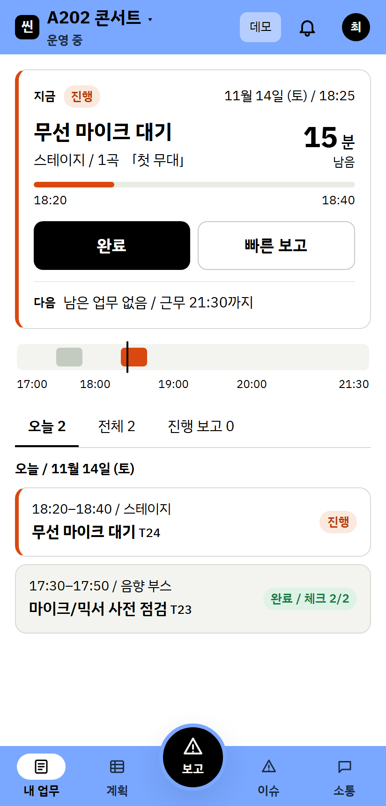

팀원은 지금 맡은 업무의 장소·시간·절차를 보고 행동하고, 끝나면 수행 결과를 남깁니다. 이 캡처에는 가상 공연의 기존 마이크 대기 업무가 표시돼 있으며, 앞 화면의 교체안이 승인된 직후를 촬영한 것은 아닙니다. **총괄 승인 → 담당자 앱에서 변경 확인 → 실제 장비 인수·설치**가 서비스의 연결 흐름입니다. 대회에서는 담당자가 지시를 확인하고 보조 마이크를 건넸으며, 제가 그 마이크로 발표를 이어갔습니다.

### 5. 총괄이 객석 관측을 보고 인력 지원을 승인합니다 · 웹

총괄은 A구역의 추정 인원·촬영 시각·관측 품질을 현장 보고와 대조합니다. 지도 점은 개인의 위치가 아니라 추정 인원을 표현합니다. 오래되거나 관측하지 못한 구역은 빗금으로 구분합니다. 지원 후보를 고를 때는 B구역에 최소 인원이 남는지도 확인합니다. 승인 후 안전요원이 앱에서 업무를 확인하고 이동하는 과정은 앞의 팀원 업무 흐름과 같습니다. 캡처의 18명·2.25명/㎡·이동 약 2분은 예시이며, 대회 실측값이 아닙니다.

2026년 11월 4일 중간 회고 화면 · 웹 6장과 Android 앱 4장

> 11월 4일 중간 회고에 실었던 웹 6장과 Android 앱 4장입니다. 화면의 인물, 공연 일정, 장비명과 수치는 데모 데이터입니다. 장비 화면과 안전 지도에서 총괄이 어떤 근거로 결정하는지 볼 수 있습니다.

### 운영 현황 (WEB, 총괄)

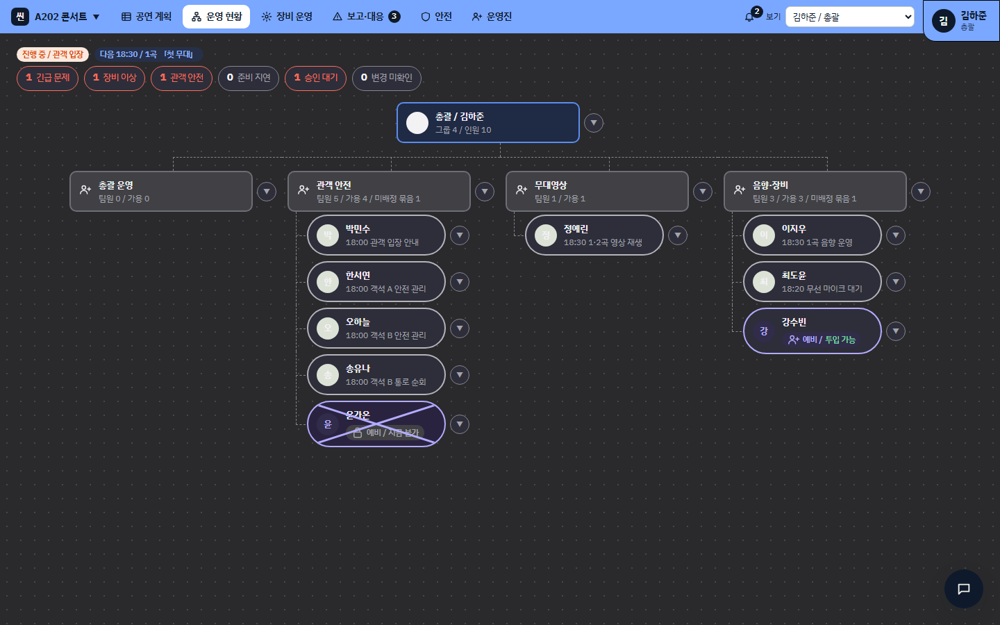
*상단에 긴급 문제·장비 이상·관객 안전·승인 대기·변경 미확인 수를 모으고, 그룹별로 누가 지금 어떤 업무를 하는지 보여준다. 예비 인원과 투입 불가 인원도 구분한다.*

### 공연 계획

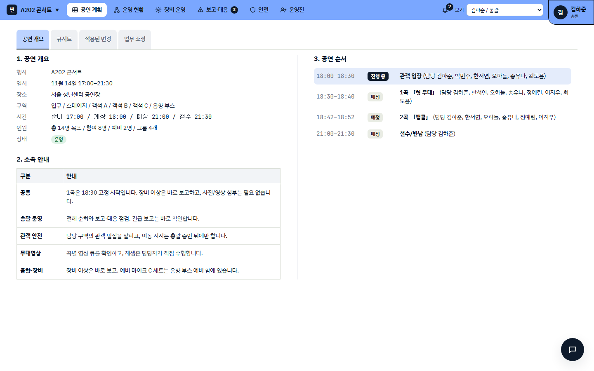

### 장비 운영

*장비마다 곡별 사용 시간과 예약을 시간표로 보여준다. 상태 옆에 "담당자 확인 / 18:22"처럼 **출처와 시각**을 같이 표시해, 자동 관측·담당자 확인·미확인을 구분한다.*

### 보고 접수와 AI 대응안

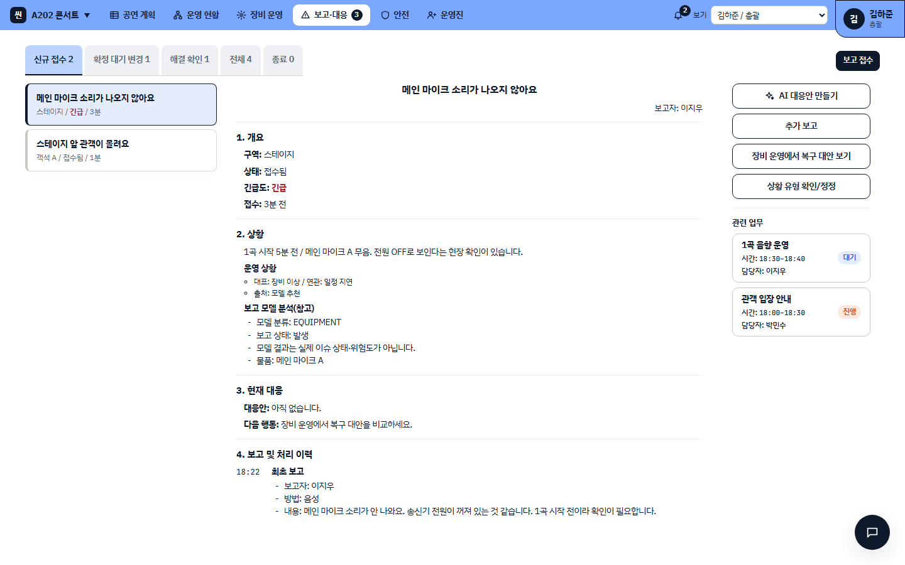
*보고 모델의 분류(EQUIPMENT 등)는 "참고"로만 표시하고, 총괄은 보고 시각, 현장 설명, 장비의 마지막 관측을 함께 볼 수 있다.*

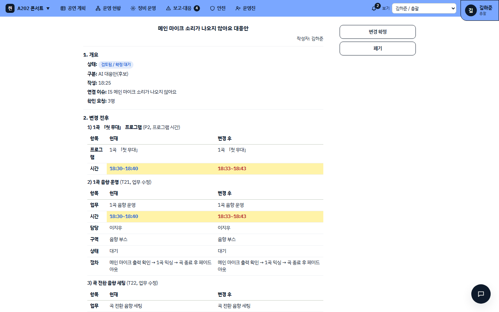
*AI 대응안은 "후보"다. 바뀌는 업무마다 현재와 변경 후를 나란히 비교하고, 총괄이 "변경 확정"을 눌러야 반영된다. 이 화면에서 총괄은 첫 곡과 음향 업무가 함께 3분 밀린다는 점을 확인할 수 있다.*

### 안전

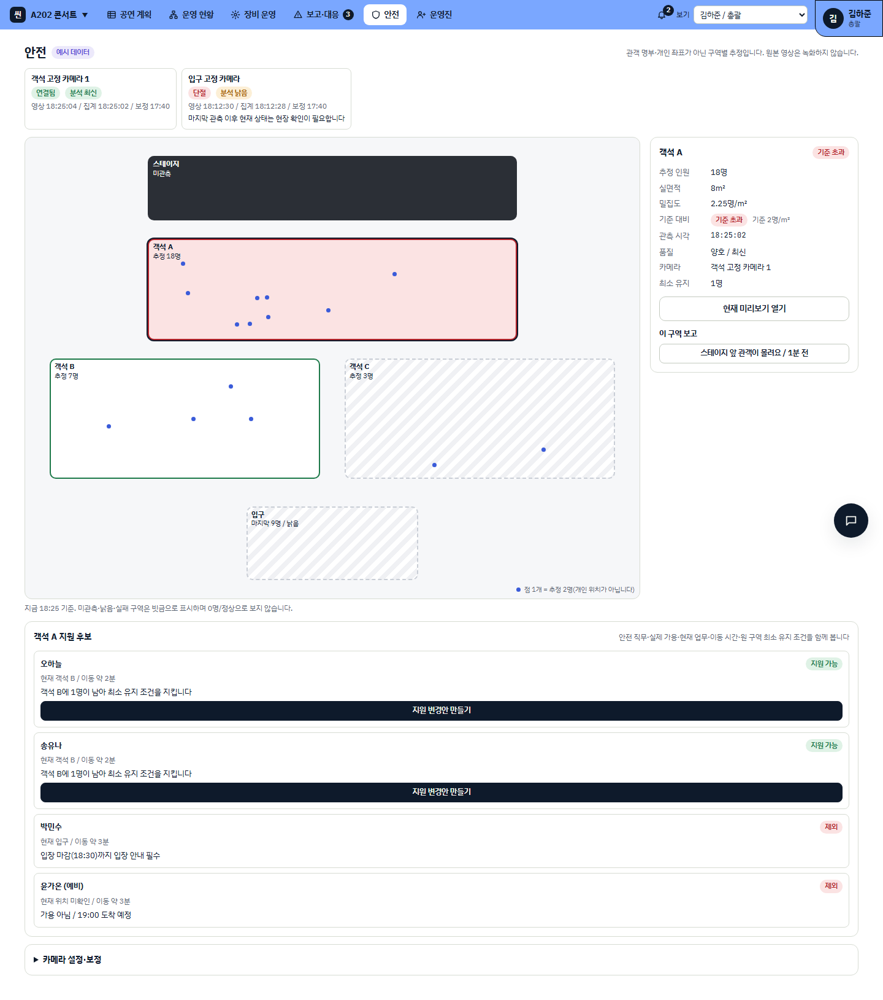
*점 하나로 구역의 **추정 인원 2명**을 표시한다. 관측하지 못했거나 오래된 구역은 빗금으로 표시하고 0명·정상으로 보지 않는다. 지원 후보는 원래 구역에 최소 인원이 남는지까지 확인해 "지원 가능 / 제외"로 나눈다.*

### 팀원 앱 (Android)

| 현황 | 내 업무 | 상황 보고 | 음성 보고 |
| --- | --- | --- | --- |
| 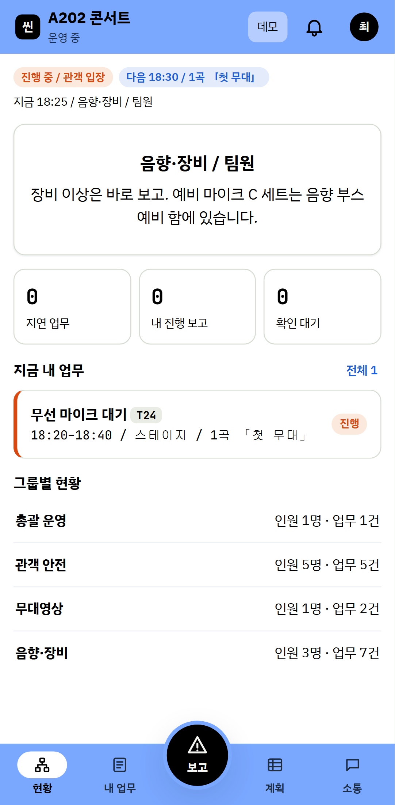 | 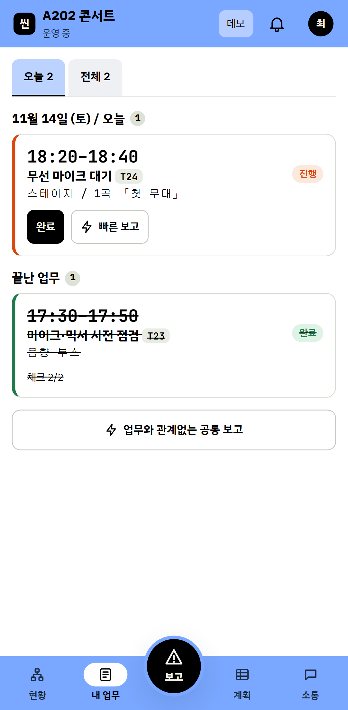 | 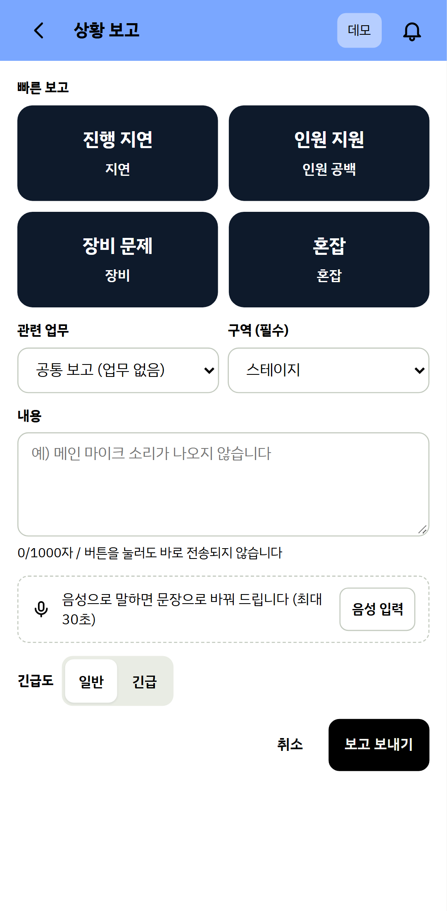 | 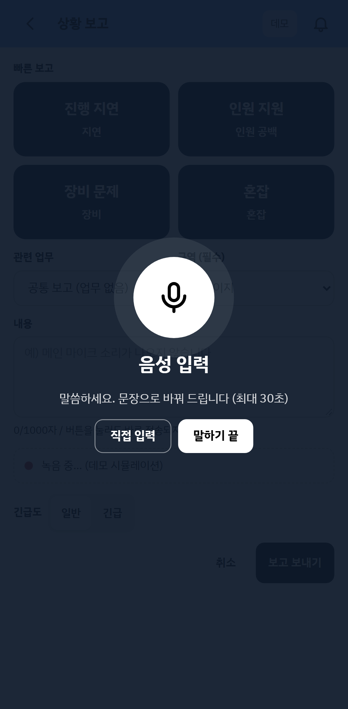 |

*당시 앱에는 현황·내 업무·계획·소통 탭과 가운데 보고 버튼이 있었다. 음성은 문장으로 바뀐 뒤 **본인이 확인하고 고쳐서** 보내야 정식 보고가 된다.*

## 시스템 구조와 승인 기준

총괄 웹과 팀원 앱은 같은 업무 서버를 사용합니다. 웹은 공연 전체와 변경 전후의 비교에, 앱은 지금 할 일과 보고·확인에 집중했습니다. 현장 노트북은 공연장의 무선 수신기를 읽고, 카메라는 객석의 지정 구역을 관측합니다. 업무 서버에는 장비 관측과 현장 보고가 각각 들어옵니다. 총괄은 두 정보의 시각과 출처를 보고 대응을 시작합니다.

구조도의 화살표는 서비스 사이의 논리적 흐름입니다. 카메라 관측은 AI 서버의 구역별 인원 추정을 거쳐 판단 근거가 되고, 음성·보고 분석과 대응 후보도 업무 서버로 돌아옵니다. **AI 서버는 분석과 후보 생성을, 업무 서버는 현재 계획·예약 대조와 승인 결과 저장을 맡습니다.** 총괄이 승인하면 업무 서버의 변경이 담당자 앱에 전달되고, 팀원은 변경 확인과 현장 수행을 각각 기록합니다. 장비나 카메라의 관측값만으로 담당자가 자동 교체되지는 않습니다.

11월 18일 보강 전 회고에 있던 간략 구조도

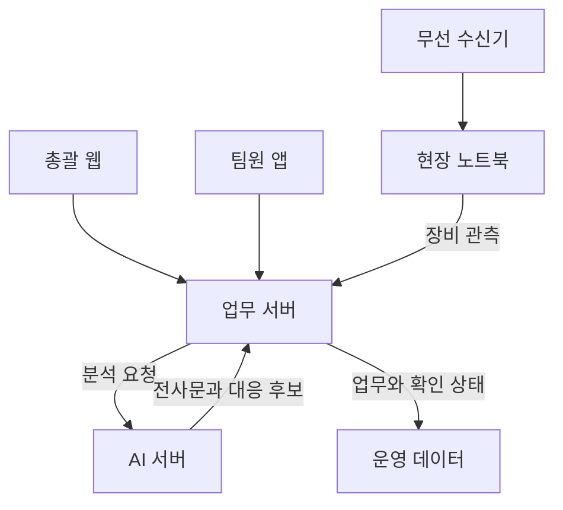

기존 간략도는 카메라 입력과 승인 후 팀원에게 돌아가는 경로를 생략하고 있었습니다. 위 PNG에서는 관측·분석·승인의 역할과 사용자에게 돌아오는 흐름을 함께 표시했습니다.

| 구성 | 맡은 일 | 이 구성이 필요했던 이유 |
| --- | --- | --- |
| 웹과 Android | 하나의 React 프로젝트에서 화면과 API 연결을 공유하고 앱 자산을 APK에 동봉 | 같은 변경을 총괄은 승인 대기 목록에서, 팀원은 내 업무에서 봅니다. 앱 화면이 바뀌면 새 APK로 업데이트해야 하므로 웹 배포일과 앱 배포일을 따로 관리했습니다. |
| 업무 서버와 저장소 | 공연 계획, 일정, 장비 예약, 보고, 변경 승인과 확인을 PostgreSQL에 기록하고 Redis를 함께 사용 | 어느 팀원이 먼저 알림을 열었든, 다시 접속하면 서버에 저장된 최신 담당자와 업무를 확인할 수 있게 했습니다. |
| AI 처리 | 별도 서버에서 음성을 전사하고 보고를 분석합니다. 대응안은 인력·일정 등 관련 역할에 작업을 나눠 맡기고 검토한 뒤 총괄에게 돌려줍니다. | 보조 마이크를 찾는 일과 그 마이크를 가져올 사람을 찾는 일은 서로 다른 조건을 봅니다. 최종 적용은 업무 서버가 현재 공연 상태와 대조합니다. |
| 현장 수집과 전달 | 수신기는 현장 노트북이 읽고, 카메라 영상은 관측 구역별 인원 추정에 씁니다. 채팅에는 WebSocket, 상태 갱신에는 SSE, 기기 알림에는 FCM을 사용하도록 구성했습니다. | 장비 관측이 끊겨도 팀원이 직접 본 상황을 보고할 수 있습니다. 화면에는 관측 시각과 마지막으로 확인한 사람이 남습니다. |

확정된 계획에 남아 있는 미배정 업무 묶음은 최초 한 번 자동 배정할 수 있습니다. 공연 중 담당자나 예약이 달라지는 변경은 총괄 승인을 거칩니다.

**변경안 두 개가 같은 계획에서 출발한 경우**가 승인 설계를 가장 잘 설명합니다. 첫 번째 승인으로 담당자나 장비 예약이 바뀌면, 두 번째 안의 미리보기는 이미 과거 상태입니다. 이 경우 최신 상태로 다시 비교해야 합니다. 한편 팀원이 변경 안내를 봤다는 사실만으로 장비가 설치됐다고 처리하면, 총괄은 실제 공연을 시작해도 되는지 판단할 수 없습니다. 그래서 알림 열람, 업무 변경 확인, 현장 수행을 별도로 기록했습니다.

11월 6일에는 시험 행사에서 화면을 연 뒤 확인 대상을 바꿔 보았습니다. 오래된 대상에 대한 확인은 서버에서 거절됐고 화면이 최신 정보를 다시 읽었습니다. 새 대상을 확인하자 확인 시각은 저장됐고, 업무는 수행 전 대기 상태를 유지했습니다. 11월 12일 운영 서버에서는 AI가 담당자를 제시하지 못하거나 공연 운영 시간 밖의 조치를 제안해 처음 두 요청이 실패했습니다. 수정 후에는 대응안이 생성됐고 총괄 화면에서 인력·안내·검토 등 각 역할의 처리 결과를 확인했습니다.

## 내가 맡은 일

### 기획 변경을 구현까지 따라가기

3주 동안 기획을 아홉 차례 개정하면서, 화면과 서버가 서로 다른 버전의 기획을 기준으로 개발되는 문제가 생겼습니다. 저는 PDF로 관리하던 기획을 Markdown 본문으로 옮기고, 결정 이유와 영향을 받는 화면·서버·AI 기능을 연결했습니다. 과거 버전은 보관하고 다음 개정 때 처리할 불일치를 기록했습니다. 팀원이 제안한 내용은 문답을 거쳐 채택한 뒤 개발 기준에 반영했습니다. 각 기능의 결정, 구현, 시험 결과를 나눠 기록해 PM이 다음 확인을 누구에게 요청할지도 알 수 있게 했습니다.

프로젝트의 기본 MR 리뷰어로서 이슈 담당, 리뷰, 병합의 기준도 정리했습니다. 같은 기능에서 에이전트가 작업하더라도 담당자가 실제 결과를 확인하도록 했습니다. 이 경험은 [Agent & Harness 학습 노트](../agent&harness/README.md)에도 정리했습니다.

### 웹·앱 공통 기반과 PDF에서 시작한 공연의 장비 복구

처음에 정한 플랫폼 기준 세 가지는 공연 운영 기능을 추가할 때도 계속 사용했습니다.

| 결정 | 이유 |
| --- | --- |
| 같은 웹 기술로 총괄 화면과 Android 앱을 만들고, 앱에는 빌드한 화면을 동봉 | 공통 기능을 함께 수정할 수 있고, 휴대폰에 설치한 화면의 버전을 APK 단위로 추적할 수 있습니다. |
| 로그인과 화면 이동은 웹·Android에 맞게 처리 | 브라우저에서 공연 링크를 여는 경우와, 외부 로그인을 마친 뒤 휴대폰 앱으로 돌아오는 경우의 이동 경로가 다릅니다. |
| 서버 데이터 조회와 업무를 바꾸는 요청의 재시도 방식을 구분 | 목록은 다시 읽어도 되지만, 보고·승인은 응답을 잃은 시점에 이미 처리됐을 수 있습니다. |

보고를 전송한 직후 네트워크가 끊기면, 사용자는 서버가 보고를 받았는지 알기 어렵습니다. 같은 버튼을 다시 눌러 보고가 두 건 쌓이면 현장에서는 장애도 두 건처럼 보입니다. 저는 웹과 앱의 요청 처리 계층을 공통화해 같은 요청을 재전송할 때 기존 요청 번호와 내용을 유지했습니다. 결과가 불명확하면 현재 상태를 다시 읽고, 사용자가 작성하던 보고와 녹음은 뒤로 가기 전에 확인하도록 했습니다. Android에서는 로그인 뒤 앱 복귀를 실기기로 확인했고, 웹에서는 알림함에서 변경을 확인한 결과가 서버에 저장되는지 검증했습니다.

후반에는 PDF를 올려 만든 공연에서도 장비 복구가 이어지는지 살폈습니다. 계획서의 장비가 화면에 보여도, 공연 중 어느 마이크와 수신기를 함께 쓰며 교체 시간에 무엇이 예약돼 있는지 서버가 알아야 후보를 계산할 수 있습니다. 저는 추출한 일정표·평면도·장비를 입력 화면과 공개 과정에 연결하고, 장비 운영 백엔드에서 마이크와 수신기의 관계를 복구 계산에 반영했습니다. 후보를 검토할 때는 호환성, 예약 충돌, 이동·설치·재시험 시간 중 무엇이 확인됐고 무엇을 사람이 확인해야 하는지 표시하도록 했습니다. 11월 17일에는 웹으로 연결한 카메라의 관측도 안전 인력 지원의 판단 근거로 받도록 수정했습니다.

### 실제 수신기에서 읽을 수 있는 것

제가 연결한 장비는 Shure QLXD4 무선 마이크 수신기입니다. 현장 노트북에서 송신기 연결 여부, 배터리, 무선 신호와 음량 상태를 수집하고 업무 서버로 전송했습니다. 실제 송신기의 전원을 껐을 때 수신기에서 송신기 종류를 더 이상 식별할 수 없다는 변화를 확인했습니다. 이때 화면에 필요한 정보는 마지막 관측 시각과 무엇이 달라졌는지입니다. 전원이 꺼진 이유나 객석에서 소리가 들리는지는 현장 팀원의 보고로 보완했습니다.

초기에는 수집 중 현장 노트북의 유선 연결이 끊긴 뒤 일부 시험에서 수신기의 네트워크 통신이 복귀하지 않았습니다. 조건을 나눠 반복하자 수집 연결의 유무에 따라 결과가 달랐습니다. 수신기의 내부 원인까지 특정할 수는 없어, 수집기가 장비를 다시 발견하는 방식과 공연 중 케이블 고정 절차를 정비했습니다. 이후 시험도 **노트북과 장비 사이의 단절**과 **수집 중 업무 서버의 중단**을 구분했습니다. 두 장애는 복구 방법도, 잃을 수 있는 데이터도 다릅니다.

### 수집이 끊겼을 때의 검증

11월 6일에는 실제 수신기와 노트북을 연결하고, 저장된 관측의 일련번호를 대조했습니다.

| 시험 조건 | 결과 | 여기서 내린 판단 |
| --- | --- | --- |
| 로컬 서버에 수신기 2대의 관측을 30분 전송 | 각 10,637건과 10,633건 저장. 두 수신기 모두 번호 누락·중복 0건 | 서로 다른 수신기의 관측을 동시에 구분해 저장할 수 있었습니다. |
| 운영 서버에 수신기 1대의 관측을 30분 전송 | 10,658건 저장. 번호 누락·중복 0건. **수집부터 서버 저장까지 중앙값 921ms, 최대 2.23초** | 시험용 공연·장비에서 운영 서버를 포함한 수집 경로를 확인했습니다. 화면 반영이나 장비 복구까지 걸린 시간은 이 측정에 포함하지 않습니다. |
| 150초 수집 시험 중 로컬 서버가 23초간 응답하지 않음 | 중단 중 기록을 노트북에 쌓고 복구 뒤 다시 전송. **시험 전체 875건** 저장 | 짧은 중단에서 재전송과 저장을 끝까지 확인했습니다. |
| 21분 수집 시험 중 처음 17분간 로컬 서버 중단 | 미전송 보관 한도 5,000건을 넘어 오래된 **1,410건 유실**. 당시에는 버려진 건수가 기록에 남지 않음 | 수집기 경고·종료 요약과 서버 로그에 유실량을 남기도록 수정했습니다. 보관 한도는 여전히 있으므로 장시간 장애 후에는 손실 여부를 확인해야 합니다. |

실기 연속 수집은 30분을 기준으로 마쳤습니다. 시뮬레이터와 기록 재생은 같은 입력으로 판독 동작을 반복 점검하는 데 사용했습니다. 믹서 USB 측정은 조건부 실험으로 검토했고 최종 실측 결과는 확인되지 않았습니다.

보관 기한은 로컬 시험 기록 22,145건의 만료 시각을 앞당기고 정리 주기를 10초로 줄여 재현했습니다. 주기 계측 22,086건은 24시간, 상태 변화 59건은 30일 보관으로 분류됐고, 각 만료 조건에서 삭제됐습니다. 최신 값 41건은 공연 진행 중에는 유지되고 종료 후 삭제됐습니다. **실제로 30일을 기다린 시험은 아니며**, 삭제된 기록을 다시 보냈을 때 수집 시각 기준으로 거절되는지는 이 시험에서 확인하지 않았습니다.

위 수치는 11월 6일 실기 시험 기록을 대조한 결과입니다. 아래의 현재 운영 집계나 11월 18일 대회 성능과 구분합니다.

## AI 평가에서 선택이 바뀐 지점

### 소음 제거보다 먼저 확인했던 것

콘서트용 음성 보고에서는 “메인 마이크”와 “예비 마이크”를 구분하는 일이 중요했습니다. 팀은 행사 보고 107문장을 합성 음성으로 만들고 음악·환호·웅성거림을 섞어 전사 결과를 비교했습니다. 평가에 사용한 범용 소음 제거를 먼저 적용하면 글자 오류율이 오히려 높아지거나 이득이 작았습니다. 최종적으로 원음에 공연의 구역명과 곡 이름 같은 문맥을 힌트로 주는 방식을 택했습니다.

같은 혼합 소음 조건(신호 대 잡음비 5dB)에서 **글자 오류율은 기본 힌트 15.4%, 공연 힌트 8.3%로 7.1%p 낮아졌습니다.** 휴대폰 실기에서는 녹음한 말이 운영 서버에서 전사돼 앱의 보고 입력 칸으로 돌아왔습니다. 무음이라는 뜻은 남았지만 마이크 이름 일부를 다르게 받아쓴 사례도 있었습니다. 팀원이 문장을 읽고 장비명을 고친 뒤 보고하는 절차를 둔 이유입니다.

### 보고 분석과 객석 추정

| 팀에서 평가한 대상 | 관찰 결과 | 제품에서 내린 판단 |
| --- | --- | --- |
| **보고 유형과 문장 안의 이름 추출** | 팀이 만든 콘서트 보고 107문장을 두 묶음으로 나누고, 학습에 쓰지 않은 묶음에서 번갈아 평가했습니다. 추가 학습 후 보고 유형별 F1의 평균은 0.717 → 0.865, 구역·장비 등 이름의 시작과 끝을 정확히 짚었는지 평가한 개체 F1은 0.723 → 0.844였습니다. | 11월 11일 운영 AI 서버의 실제 보고 응답에서 새 모델 사용을 확인했습니다. 최종 배포 모델은 107문장 전부로 학습했습니다. 위 점수는 교차 평가 결과입니다. 운영 환경에서 접수부터 분석 완료까지 걸리는 시간의 최종 측정값은 확인되지 않았습니다. |
| **구역별 추정 인원** | 전시장 로비 CCTV 한 대의 13장을 이용해 구역별로 정답 인원과 비교했습니다. 가까운 대기 줄에서는 DM-Count 후보의 평균 절대 오차가 약 2.3명이었고, 먼 뒤편에서는 모든 후보가 크게 과소 추정했습니다. | 구역을 화면에 지정해 밀도를 합산하고 관측 범위와 촬영 시각을 함께 보여줍니다. 원거리를 심하게 적게 세는 구역은 관측 대상에서 빼도록 했습니다. 대회에서 카메라와 인력 지원 흐름을 시연했고, 어두운 공연장 전체에 적용할 정확도는 별도 측정이 필요합니다. |

음성과 군중 모델의 학습·평가는 AI 담당 팀원의 작업입니다. 저는 현장 팀원이 전사문을 확인하는 화면, 총괄이 관측 품질과 지원 후보를 보는 흐름, 웹 카메라 관측과 지원 판단의 연결을 담당했습니다.

## 실서버·실기기에서 확인한 범위

- **프론트엔드 회귀 시험.** 11월 4일 음성 보고 연동 당시 FE 시험 37개 파일의 486건이 통과했고 웹·Android용 자산 빌드도 성공했습니다. 아래 실서버 기록은 그 뒤 실제 연결에서 확인한 결과입니다.
- **웹과 Android.** 11월 6일 화면과 업무 서버 사이에서 알림함 조회 및 변경 확인을 검증했고, 11월 11일에는 Android 기기에서 소셜 로그인 후 앱으로 복귀하는 경로를 확인했습니다. 0.5.0은 시연 휴대폰 설치 기록이 있고 0.7.0은 11월 13일 공개 배포 기록이 있습니다. 당일 사용한 APK의 정확한 버전은 특정하지 않았습니다.
- **카메라.** 11월 11일 실제 웹캠을 연결해 운영 웹에 현재 영상과 촬영·수신 시각이 표시되는 것을 확인했습니다. 이후 웹에서 연결한 카메라의 관측을 지원 후보 판단까지 이어 붙였습니다. 11월 18일 시연에서는 안전요원이 앱에서 승인된 업무를 확인하고 이동했습니다.
- **업무 서버.** 11월 13일 팀 QA 보고서에서는 당시 집계한 HTTP 접점 125개 중 119개에 요청과 응답을 직접 검증한 기록이 있고 6개는 당시 MVP 범위에서 제외했습니다. 핵심 통합 시험은 실제 HTTP, 권한 검사, PostgreSQL, Redis를 거쳤습니다. 자동 배정과 변경안 생성의 AI 응답, 기기 푸시 발송은 해당 시험에서 대역으로 처리했습니다.
- **공연 종료.** 공연 종료와 일회 요약 생성, 웹의 요약 조회 버튼, 복사 동작에 대한 구현과 시험 기록을 확인했습니다. 대회 시연은 마이크 교체와 객석 지원을 중심으로 구성했습니다.

### 현재 운영 지표: 미확인

11월 18일 15:38 KST에 재진단했습니다. 업무 서버는 호스트 키 검증까지 통과했지만 로컬 SSH 키 파일의 접근 권한 검사에 막혔고, AI 서버는 SSH 포트 연결이 시간 초과됐습니다. 두 서버 모두 이번 조회에서 운영 데이터나 실행 중인 분석 서비스를 확인하지 못했습니다. 빈칸은 미조회 값이며 0건을 뜻하지 않습니다.

| 지표 | 집계할 이벤트와 표본 기준 | 건수·표본 수 | 결과 |
| --- | --- | --- | --- |
| 보고 접수 건수 | 조회 시점 직전 24시간에 서버에 생성된 보고 | | |
| 승인 후 적용된 변경 건수 | 같은 기간에 적용 시각이 기록된 변경안 | | |
| 종료 시각이 기록된 AI 작업 건수 | 같은 기간에 종료 시각이 기록된 작업. 성공·실패 구분도 함께 확인 | | |
| AI 작업 처리 시간 중앙값 | 위 종료 작업 중 생성·종료 시각이 모두 유효한 표본의 생성부터 종료까지 시간 | | |

집계 시에는 조회 트랜잭션의 기준 시각과 직전 24시간의 시작·종료를 UTC와 KST로 함께 기록하고, 테스트·시연 공연의 포함 여부를 확인해야 합니다. 아직 조회하지 않아 실제 집계 기간, 표본 수와 데이터 혼재 여부는 확정하지 않았습니다. AI 서버에서 얻을 수 있는 서비스별 처리량·지연의 집계 범위도 미확인입니다. 과거 시험이나 화면의 가상 수치로 이 칸을 채우지 않았습니다.

## 기여 범위와 집계 기준

통합 개발 브랜치의 11월 17일 이력에서 병합 커밋을 제외해 세었습니다. 제 두 작성자 표기를 합쳐 **전체 1,078개 중 459개**입니다. 한 커밋이 여러 폴더를 바꾸면 각 폴더에 한 번씩 잡히므로 아래 행을 더해 전체 기여를 구하지 않습니다. 리뷰와 병합도 이 수치에서는 제외했습니다.

| 영역 | 내 작성 커밋 / 해당 영역 전체 | 실제 맡은 일 |
| --- | --- | --- |
| 프론트엔드 | 219 / 294 | 웹·앱 공통 기반, 서버 응답 연결, 현장 보고·장비·안전 화면과 실기기 검증. UI/UX 담당자와 협업 |
| 장비 수집 | 16 / 16 | 수신기 발견·판독, 수집과 재전송, 복수 수신기 연결, 실기 검증 |
| 백엔드 | 61 / 368 | 장비 상태와 예약 조건, 교체 후보 계산, PDF로 준비한 공연의 장비 복구, 웹 카메라 관측 반영 |
| 문서 | 229 / 378 | 기획 개정, 결정 기록, 기능 사이 불일치 추적, 검증 결과 정리 |
| AI / 인프라 | 각각 27 / 151, 3 / 44 | PDF 추출 결과와 계획 입력의 연결 등 담당 기능에 필요한 변경. 모델 학습·평가와 운영 인프라는 각 담당 팀원이 주도 |

## 배운 점

**장비를 연결할 때는 정상 수집과 장애 후 복구를 따로 시험하게 됐습니다.** 30분간 데이터가 빠짐없이 쌓이는 것을 보고도, 서버가 오래 멈췄을 때 무엇이 사라졌는지는 알 수 없었습니다. 보관 한도를 넘겨 본 뒤에야 누락량을 운영자가 볼 수 있어야 한다는 요구사항이 나왔습니다.

**모델을 고르는 기준도 운영자의 다음 행동에서 찾았습니다.** 멀리 있는 군중을 적게 세면 총괄에게는 한산한 구역처럼 보입니다. 마이크 이름 한 글자가 틀리면 다른 장비의 교체 업무가 될 수 있습니다. 그래서 정확도 수치와 함께 사람이 어디서 오류를 발견하고 바로잡을지를 설계했습니다.

**공연 중에는 승인 뒤의 한 단계가 더 필요했습니다.** 총괄 화면에 교체 업무가 생겨도 무대에서는 여전히 소리가 나지 않습니다. 대회에서 제가 보조 마이크를 받아 다시 말할 때까지 한 장면으로 보여준 이유입니다. 다음에도 현장 업무를 설계할 때는 요청한 사람의 화면과 함께, 실제로 움직일 사람이 무엇을 보고 어떻게 완료를 알리는지 확인하겠습니다.
