# 씬크루 (SceneCrew)

**첫 곡 직전 메인 마이크에서 소리가 끊기면, 총괄은 어느 장비를 누가 가져올지 정해야 합니다.** 예비 마이크의 전원이 켜져 있어도 다른 팀이 사용할 시간이면 교체가 어렵습니다. 단체 채팅에 지시를 올려도 담당자가 읽었는지, 장비를 실제로 건넸는지는 따로 확인해야 합니다.

씬크루는 콘서트 계획서, 현장 팀원의 보고, 장비와 객석의 관측값을 한 공연의 업무에 연결한 웹·Android 서비스입니다. 총괄은 대응안을 검토해 업무를 변경하고, 팀원은 앱에서 지시를 확인한 뒤 수행 결과를 남깁니다.

| 항목 | 내용 |
| --- | --- |
| 프로젝트 | SSAFY 15기 자율 프로젝트, 6인 팀, 2026년 10월 13일 개발 기록 시작, 11월 17일 시연 영상 촬영, 11월 18일 대회 시연 완료 |
| 내 역할 | PM·기획, 웹·Android 공통 기반과 API 연동, 무선 마이크 상태 수집기, 장비 상태·복구 백엔드 개발 |
| 팀 협업 | UI/UX, 인증·채팅·알림, 계획·변경 승인, AI 모델·데이터, 인프라·배포를 담당한 팀원들과 화면과 데이터의 기준을 맞췄습니다. |
| 주요 기술 | React·TypeScript·Capacitor Android, Java·Spring Boot, PostgreSQL·Redis, Python·FastAPI·LangGraph, Docker Compose |
| 회고 기준 | 11월 17일까지 통합된 개발 이력, 날짜별 시험·배포 기록, 11월 17일 촬영한 시연 영상과 같은 날의 운영 서버 기록, 2026-11-19 운영 서버 조회. 대표 화면은 통합 소스로 로컬 재현했고, 11월 4일 데모 화면은 접어서 보관했습니다. |

## 운영계획서에서 현장 조치까지

| 장면 | 사용자가 보고 결정하는 것 |
| --- | --- |
| 공연 준비 | 총괄이 운영계획서 PDF를 올리면 공연 정보와 일정표에서 초안을 만듭니다. 장비 목록과 평면도가 있으면 해당 입력 화면에 채우고, 총괄이 빠진 조건을 바로잡아 공개합니다. 직무 그룹에 참여한 팀원에게 최초 미배정 업무를 연결합니다. |
| 마이크 이상 보고 | 현장 노트북이 무선 수신기의 관측값을 전달합니다. 팀원은 무대에서 들은 현상을 앱에 말하고, 전사문에 장비명이 맞는지 고친 뒤 보고합니다. 총괄은 누가 무엇을 들었는지와 장비가 마지막으로 보낸 상태를 함께 봅니다. |
| 교체와 업무 변경 | 총괄은 교체할 장비의 예약 시간과 교체 업무를 맡을 사람을 확인합니다. 같은 시각에 다른 변경이 먼저 승인됐다면 최신 상태로 다시 미리 봅니다. 승인한 업무는 담당자 앱에 표시되고, 지시 확인과 실제 인수·설치는 별도로 기록합니다. |
| 관객 안전 | 안전 지도에서 카메라가 비추는 구역의 추정 인원, 촬영 시각, 관측 품질을 봅니다. A구역에 지원이 필요하면 B구역에 남을 최소 인원과 후보자의 기존 업무를 확인하고 총괄이 지원안을 승인합니다. |
| 공연 마감 | 총괄이 공연을 종료하고 운영 요약을 한 번 생성해 복사하거나 로컬에 저장할 수 있도록 구현했습니다. 서버에는 요약 생성 시도를 기록하고 요약문 원문은 보관하지 않는 설계를 적용했습니다. |

## 11월 18일 대회 시연 영상

대회 시연은 팀원들이 직접 출연해 11월 17일에 촬영한 영상으로 진행했습니다. 현장 장면은 연기해서 찍었고, 웹과 앱 화면은 운영 서버에서 처리한 작업을 녹화했습니다. 영상은 세 장면으로 이어집니다.

1. **공연 하루 전: 계획서에서 큐시트까지.** 총괄이 계획서 앞에서 고민하는 장면에 이어, 총괄 웹에서 공연계획서 PDF를 올려 추출하고 모두가 공유하는 계획과 큐시트가 만들어지는 화면을 보여줍니다.
2. **메인 마이크 중단과 복구.** 공연 중 소리가 끊기자 장비 운영팀원이 앱에서 음성으로 보고합니다. 총괄은 접수된 보고에서 복구 대안을 계산하고, 바뀌는 업무와 담당자를 확인한 뒤 승인합니다. 담당자의 앱에 "내 업무가 바뀌었습니다"가 표시되고, 담당자는 보조 마이크를 무대로 가져가 공연자에게 건넵니다. 공연이 다시 이어집니다.
3. **객석 A구역 인력 지원.** 관객이 무대 앞 A구역으로 몰리자 카메라가 A구역을 비추고, 장비 운영팀원이 혼잡을 음성으로 보고합니다. 총괄은 안전 지도에서 A구역의 기준 초과와 B구역의 추정 밀집도를 비교하고, 기존 업무와 겹치지 않는 지원 후보를 승인합니다. B구역 안전 담당자가 앱에서 변경을 확인하고 A구역으로 이동하며, 안전 지도에서 A구역 밀집도가 기준 이내로 내려갑니다.

화면 녹화의 근거는 운영 서버 기록에 남아 있습니다. 11월 17일 서버에는 보고 5건(음성 첨부 4건), 승인·적용된 변경 2건(16:06, 18:02), 담당자의 변경 확인 2건(16:07, 18:02)이 기록됐고, 객석 카메라 관측은 18:07까지 수신됐습니다. 장면은 따로 촬영한 뒤 편집으로 시간 순서를 맞췄습니다. 아래 캡처는 같은 기능을 설명하기 위해 가상 공연으로 다시 연 화면입니다.

## 문제 정의

### 처음에는 교사와 학생 운영진을 생각했습니다

운동회를 준비하는 교사, MT 운영진, 발표회를 준비하는 팀처럼 운영이 본업이 아닌 사람들은 계획서는 만들어도 **당일 현장에서 무슨 일이 생겼을 때 누구를 어디로 보내야 하는지** 판단하기 어렵습니다. 업무가 엑셀·단톡방·구두 지시로 흩어져 있어서, 변경이 생기면 "누가 알고 있고, 누가 실제로 움직였는지"를 확인할 방법이 없습니다.

### 11월 2일, 콘서트 현장으로 범위를 좁혔습니다

대회 시연을 준비하면서, 범용 행사에서 **콘서트 운영**으로 대상을 좁히고 네 가지를 더했습니다.

| 추가한 것 | 풀려는 문제 |
| --- | --- |
| 장비 복구 대안 계산 | 메인 마이크가 꺼졌을 때 예비 장비·담당자·이동 시간·예약 충돌을 따져 실제로 가능한 복구안을 고르기 |
| 고정 카메라 기반 구역별 안전 지원 | 특정 객석 구역에 관객이 몰릴 때, 다른 구역의 최소 인원을 지키면서 지원 인력을 보내기 |
| 소음 속 음성 보고 | 음악과 환호가 섞여도 장비명과 구역명을 알아들을 수 있도록 전사 방식 비교 |
| 운영 상황 유형화 | 장비 이상·일정 지연·인력 공백·관객 안전 같은 상황마다 가능한 대응과 "판단 불가" 조건을 미리 정의 |

### 기획이 바뀌어도 유지한 운영 원칙

이 프로젝트에서 가장 많이 한 일은 **기획을 고치고, 고친 기획이 코드·계약과 어긋나지 않게 맞추는 일**이었습니다.

| 시점 | 버전 | 무엇이 바뀌었나 |
| --- | --- | --- |
| 10/13 ~ 10/20 | v3.0 ~ v4.1 | PDF 기획서로 시작. 버전마다 PDF를 다시 만들면서 문서 사이 불일치가 쌓임 |
| 10/20 | (전환) | **기획 관리를 Markdown으로 전환.** 이전 기획서는 별도 보관하고, 문서 간 불일치 목록을 만듦 |
| 10/22 | v5.0 | BE 범위 조정에 맞춘 전면 개정 |
| 10/23 | v5.9 → v6.0 | 대상(비전문 운영자)·권한(총괄 직속, 사람 팀장 제거)·종료 출력 축소. 정밀 검수 후 v6.0 확정 |
| 10/24 ~ 10/26 | v7.0 | 백엔드·음성 분석 기준 정렬. 기획을 "검토안"에서 **개발 기준**으로 전환 |
| 10/27 | v8.0 | 통합 개정. 다음 날 대회 시연 일정 확정 |
| 11/02 | v9.0 | **콘서트 운영으로 전환**, 장비·안전·소음·상황 유형 통합 |

축소할 때도 기준을 세웠습니다. 10월 23일에는 조직 계층과 과거 상태 보관을 줄이면서도 **현재 업무, 보고, 승인, 수행 기록**은 유지하기로 했습니다. 덕분에 11월에 장비와 안전 기능을 추가할 때도 기존 승인 절차를 사용할 수 있었습니다.

## 사용자와 운영 상황

하루 운영 팀은 총괄, 팀원, 예비 인원으로 구성됩니다. 총괄은 계획을 확정하고 변경을 승인하고, 팀원은 직무 그룹에 참여해 자기에게 배정된 업무를 수행하고 보고하며, 예비 인원은 총괄이 승인해야 투입됩니다. 권한은 총괄과 팀원 두 가지로 유지하고, 그룹은 소속을 나누는 분류일 뿐 승인권이 없습니다.

콘서트 현장에서 일어나는 문제는 여섯 가지 상황으로 나눠 다룹니다. 상황마다 AI와 서버 계산이 맡는 일과 사람이 맡는 일을 미리 정했습니다.

| 상황 | AI·계산이 하는 일 | 사람이 하는 일 |
| --- | --- | --- |
| 일정 지연 | 지연이 후속 공연, 준비, 영상, 장비 반납에 미치는 영향과 변경 후보를 계산 | 총괄이 고정 조건과 변경 전후를 확인해 승인 |
| 인력 공백 | 기존 업무, 이동, 원래 구역 유지 조건을 만족하는 후보와 제외 이유를 조회 | 총괄이 담당 변경이나 예비 투입을 승인 |
| 업무 충돌 | 같은 인원·장비의 겹치는 시간과 조정 가능한 대안을 검증 | 총괄이 조정안을 선택 |
| 장비 이상 | 확인된 사실과 원인 미확인을 나눠, 복구 대안의 준비 시간·예약 충돌·공연 영향을 계산 | 담당자가 현장에서 확인해 기록하고 총괄이 승인 |
| 공연 순서 변경 | 요청한 순서의 실행 가능성과 관련 변경의 전후 차이를 계산 | 총괄이 공연 조건과 전후 비교를 승인 |
| 관객 안전 | 구역별 집계, 밀집도, 기준 대비 상태, 지원 후보와 원래 구역의 공백을 검토 | 담당자가 현장을 확인하고 총괄이 지원을 승인 |

모든 상황은 정보 부족, 수행 불가, 유효한 후보 없음, 오래된 근거, 중복 요청, 권한 상실을 처리합니다. 대안이 없으면 성공 문구를 만들지 않고, 필요한 조건과 사람이 직접 대응하는 경로를 돌려줍니다. 같은 사건에 장비 이상과 일정 지연, 안전 문제가 함께 있으면 대표 유형 하나 때문에 다른 대응이 빠지지 않도록 연관 상황을 여러 개 둘 수 있게 했습니다.

## 서비스 화면

11월 17일 통합 소스로 웹과 Android용 화면 자산을 로컬 빌드해 재현했습니다. 화면의 인물·공연 일정·장비 상태·인원·이동 시간은 가상 데이터입니다. **앱 두 장은 모바일 브라우저로 연 Android용 화면이며, 휴대폰 실기기나 대회 현장을 촬영한 사진은 아닙니다.** 화면 안의 11월 14일과 18:25도 가상 공연의 기준 시각입니다.

### 1. 현장 팀원이 이상을 보고합니다 · 앱

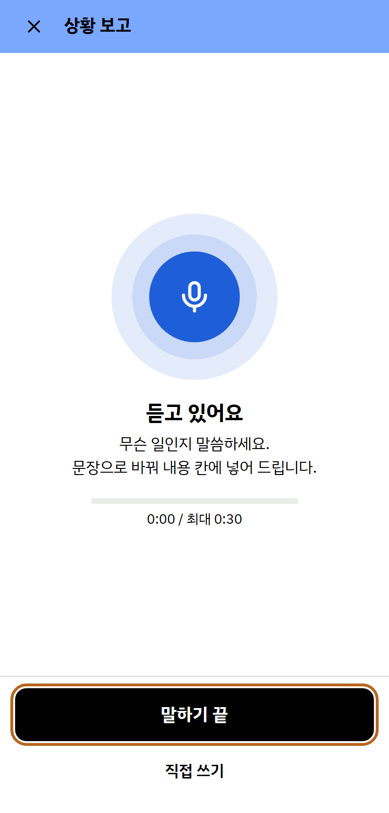

무대에서 소리가 나지 않는 것을 들은 장비 운영팀원이 상황을 말합니다. 녹음이 끝나면 전사문에서 장비명과 구역명을 확인하고 고친 뒤 보고를 보냅니다. 이 캡처는 음성 입력 중인 화면입니다. 시연 영상에서는 장비 운영팀원이 앱으로 보낸 음성 보고가 총괄에게 접수되며, 11월 17일 운영 서버에는 음성 파일이 붙은 보고 4건이 전사 작업과 함께 기록됐습니다.

### 2. 총괄이 장비 관측과 예약을 대조합니다 · 웹

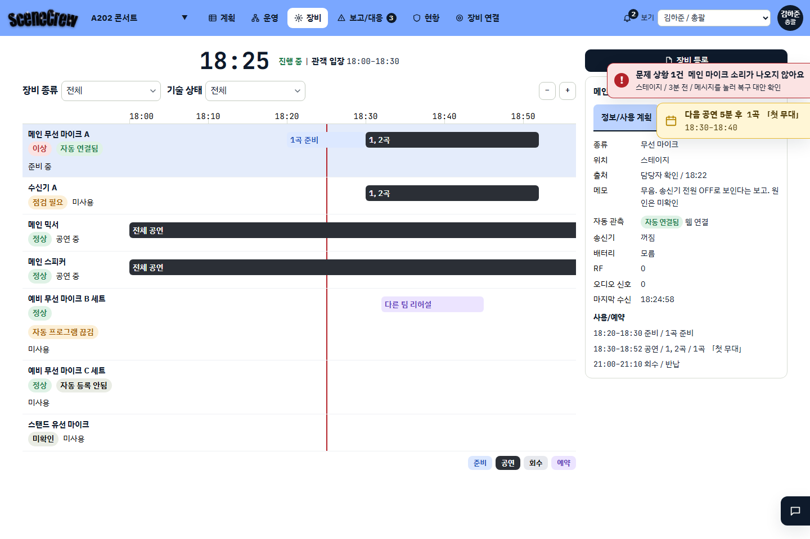

총괄은 현장 보고와 함께 메인 마이크의 송신기 상태, 배터리의 확인 가능 여부, 마지막 수신 시각을 봅니다. 예비 마이크 B는 정상이어도 다른 팀의 리허설 예약이 있으므로 바로 가져올 수 있다고 판단하지 않습니다. 자동 관측과 담당자 확인의 출처·시각을 구분하고, 교체 후보의 사용 시간을 확인합니다. 시연 영상에서는 공연 중 소리가 끊긴 상황에서 총괄이 이 화면으로 교체 판단을 이어갑니다.

### 3. 총괄이 변경 전후를 검토하고 승인합니다 · 웹

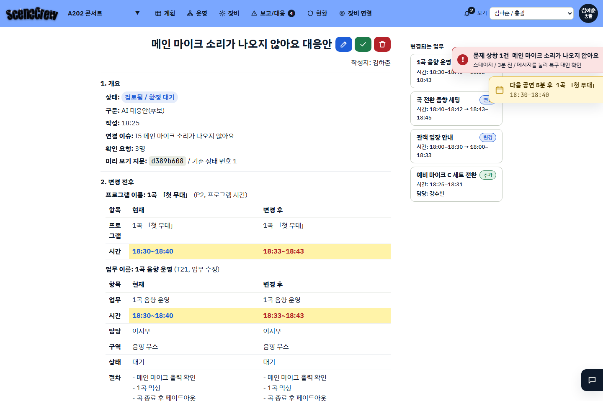

총괄은 교체 업무의 담당자와 관련 일정이 함께 바뀌는지 확인한 뒤 승인합니다. 캡처의 첫 곡 18:30 → 18:33은 가상 대응안의 변경 예시입니다. 기준 상태가 달라지면 최신 상태로 다시 비교해야 합니다. 시연 영상에서는 총괄이 보조 마이크 교체 업무와 담당자를 확인해 승인했고, 이 승인은 11월 17일 16:06에 운영 서버의 적용된 변경으로 기록됐습니다.

### 4. 팀원이 자기 업무를 보고 현장에서 수행합니다 · 앱

팀원은 지금 맡은 업무의 장소·시간·절차를 보고 행동하고, 끝나면 수행 결과를 남깁니다. 이 캡처에는 가상 공연의 기존 마이크 대기 업무가 표시돼 있으며, 앞 화면의 교체안이 승인된 직후를 촬영한 것은 아닙니다. **총괄 승인 → 담당자 앱에서 변경 확인 → 실제 장비 인수·설치**가 서비스의 연결 흐름입니다. 시연 영상에서는 담당자의 앱에 변경이 표시되고, 담당자가 확인한 시각이 승인 직후인 16:07에 서버에 남았습니다. 이어지는 현장 컷에서 담당자가 보조 마이크를 무대로 가져가 공연자에게 건넵니다.

### 5. 총괄이 객석 관측을 보고 인력 지원을 승인합니다 · 웹

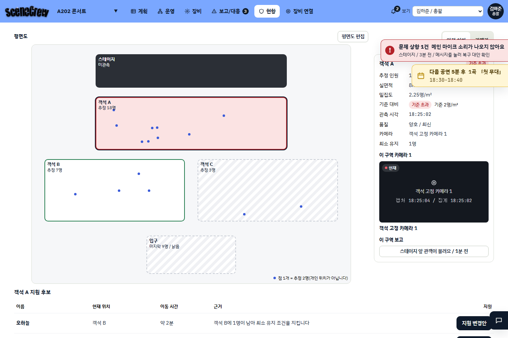

총괄은 A구역의 추정 인원·촬영 시각·관측 품질을 현장 보고와 대조합니다. 지도 점은 개인의 위치가 아니라 추정 인원을 표현합니다. 오래되거나 관측하지 못한 구역은 빗금으로 구분합니다. 지원 후보를 고를 때는 B구역에 최소 인원이 남는지도 확인합니다. 승인 후 안전요원이 앱에서 업무를 확인하고 이동하는 과정은 앞의 팀원 업무 흐름과 같습니다. 캡처의 18명·2.25명/㎡·이동 약 2분은 가상 공연의 예시값입니다. 시연 영상에서는 이 승인이 11월 17일 18:02에 적용되고 B구역 안전 담당자의 확인이 18:02에 기록됐습니다.

### 6. 총괄이 계획과 실제 진행을 한 화면에서 봅니다 · 웹

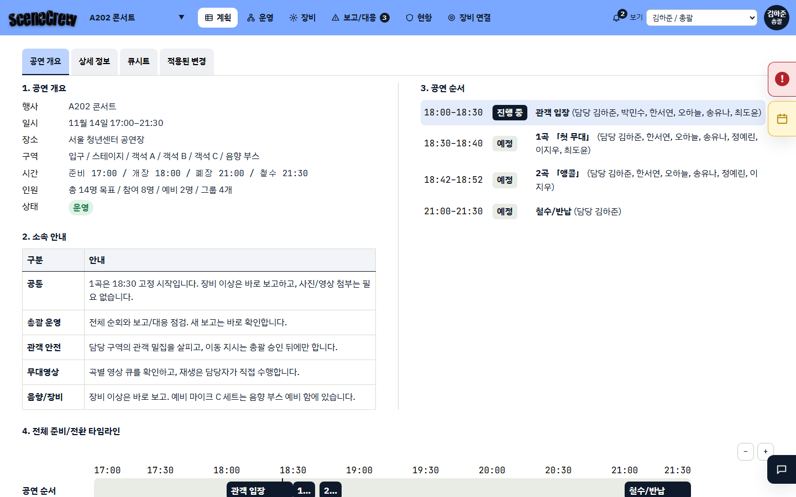

공연 계획 화면은 PDF에서 만든 계획이 그대로 운영 화면이 된 모습입니다. 왼쪽에는 공연 개요(구역 6개, 총 14명 목표, 참여 8명, 예비 2명, 직무 그룹 4개)와 그룹별 소속 안내가 있고, 오른쪽에는 공연 순서가 있습니다. 지금 진행 중인 순서(관객 입장)는 강조되고, 각 순서마다 담당자가 이어서 보입니다. 아래의 전체 준비·전환 타임라인에서는 관객 입장, 1곡, 2곡, 철수 같은 프로그램의 시간 배치를 한눈에 볼 수 있습니다.

### 7. 큐시트에서 업무와 그룹별 부담을 함께 봅니다 · 웹

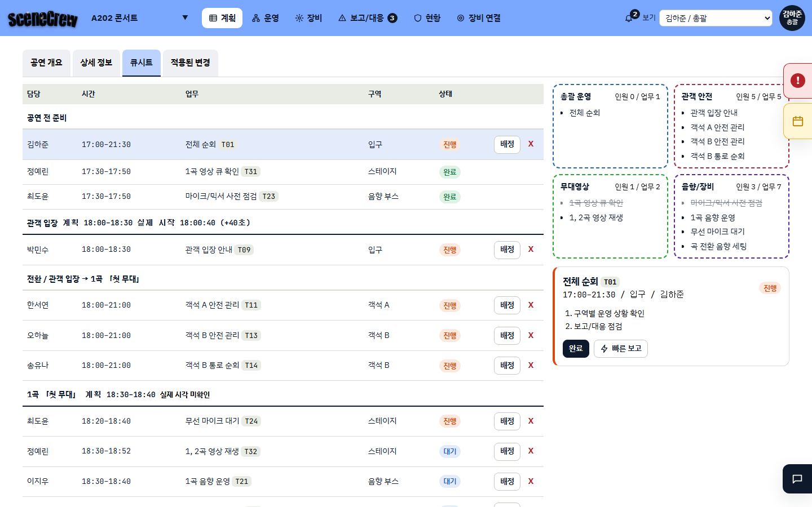

큐시트는 담당자, 시간, 업무, 구역, 상태를 한 표에 두고 업무마다 배정 버튼을 둡니다. 공연 순서마다 계획 시간과 실제 시작 시각의 차이(관객 입장 +40초)를 함께 표시합니다. 오른쪽에는 직무 그룹 네 개의 인원과 업무 수가 있고, 업무를 고르면 수행 절차와 완료, 빠른 보고 버튼이 나옵니다.

### 8. 운영 현황에서 누가 지금 무엇을 하는지 봅니다 · 웹

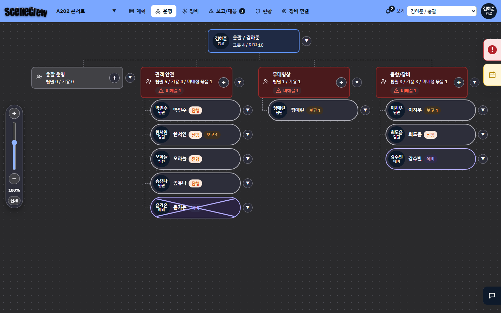

총괄을 루트로 직무 그룹 네 개와 팀원이 트리로 펼쳐집니다. 그룹 카드에는 팀원 수, 가용 인원, 미배정 업무 묶음이 보이고, 해결되지 않은 문제가 있는 그룹은 붉게 표시합니다. 팀원 노드에는 현재 업무 상태와 접수된 보고 수가 붙습니다. 예비 인원은 보라색 테두리로 구분하고, 투입할 수 없는 예비는 취소선으로 표시합니다.

### 9. 장비 연결에서 수신기 관측 상태를 봅니다 · 웹

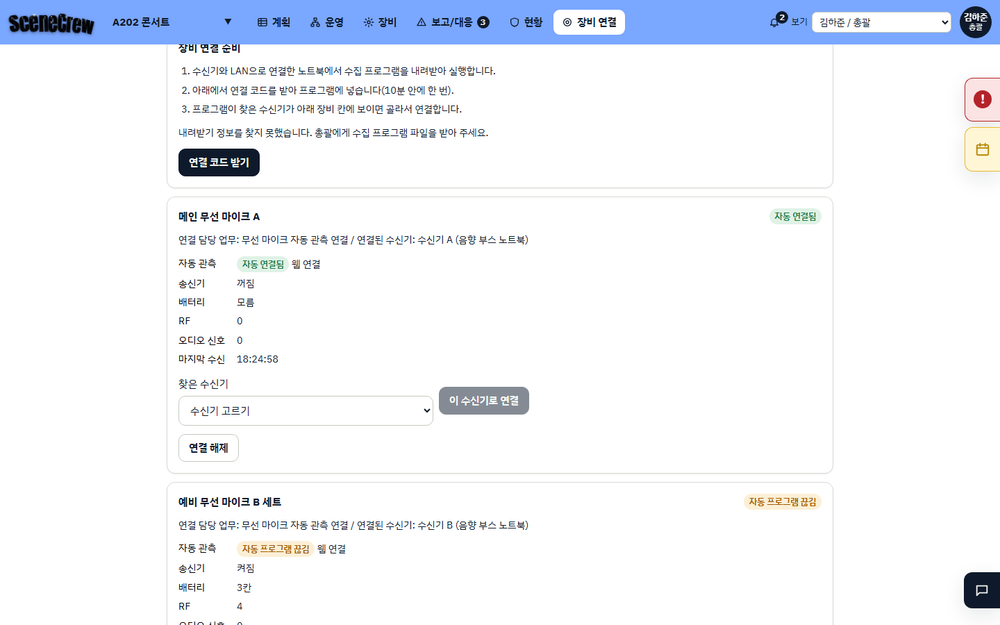

현장 노트북의 수집 프로그램을 연결하는 순서를 세 단계로 안내합니다. 연결 코드는 10분 안에 한 번만 쓸 수 있고, 프로그램이 찾은 수신기를 장비 칸에서 골라 연결합니다. 장비 칸에는 송신기 전원, 배터리, 무선 신호, 오디오 신호, 마지막 수신 시각이 나옵니다. 메인 마이크 A는 송신기가 꺼짐이고 마지막 수신이 18:24:58로 남아 있으며, 예비 마이크 B는 수집 프로그램이 끊긴 상태와 송신기 켜짐·배터리 3칸이 따로 표시됩니다. 장비 상태와 수집 프로그램의 연결 상태를 분리해서 보여줘야 "마이크가 꺼진 것"과 "관측이 끊긴 것"을 구분할 수 있습니다.

이 네 장은 앱에 내장된 데모 공연(서버 없이 동작)을 2026년 11월 19일 최신 소스로 띄워 캡처했습니다. 화면의 인물, 공연 일정, 장비 상태와 수치는 가상 데이터입니다.

2026년 11월 4일 중간 회고 화면 · 웹 6장과 Android 앱 4장

> 11월 4일 중간 회고에 실었던 웹 6장과 Android 앱 4장입니다. 화면의 인물, 공연 일정, 장비명과 수치는 데모 데이터입니다. 장비 화면과 안전 지도에서 총괄이 어떤 근거로 결정하는지 볼 수 있습니다.

### 운영 현황 (WEB, 총괄)

*상단에 긴급 문제·장비 이상·관객 안전·승인 대기·변경 미확인 수를 모으고, 그룹별로 누가 지금 어떤 업무를 하는지 보여준다. 예비 인원과 투입 불가 인원도 구분한다.*

### 공연 계획

### 장비 운영

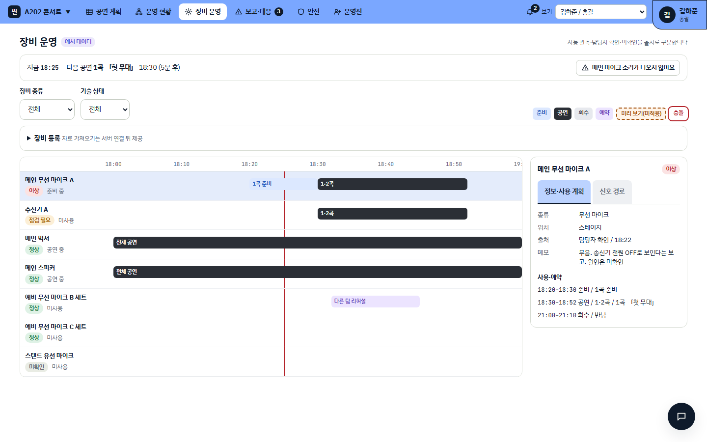
*장비마다 곡별 사용 시간과 예약을 시간표로 보여준다. 상태 옆에 "담당자 확인 / 18:22"처럼 **출처와 시각**을 같이 표시해, 자동 관측·담당자 확인·미확인을 구분한다.*

### 보고 접수와 AI 대응안

*보고 모델의 분류(EQUIPMENT 등)는 "참고"로만 표시하고, 총괄은 보고 시각, 현장 설명, 장비의 마지막 관측을 함께 볼 수 있다.*

*AI 대응안은 "후보"다. 바뀌는 업무마다 현재와 변경 후를 나란히 비교하고, 총괄이 "변경 확정"을 눌러야 반영된다. 이 화면에서 총괄은 첫 곡과 음향 업무가 함께 3분 밀린다는 점을 확인할 수 있다.*

### 안전

*점 하나로 구역의 **추정 인원 2명**을 표시한다. 관측하지 못했거나 오래된 구역은 빗금으로 표시하고 0명·정상으로 보지 않는다. 지원 후보는 원래 구역에 최소 인원이 남는지까지 확인해 "지원 가능 / 제외"로 나눈다.*

### 팀원 앱 (Android)

| 현황 | 내 업무 | 상황 보고 | 음성 보고 |
| --- | --- | --- | --- |
|  |  |  |  |

*당시 앱에는 현황·내 업무·계획·소통 탭과 가운데 보고 버튼이 있었다. 음성은 문장으로 바뀐 뒤 **본인이 확인하고 고쳐서** 보내야 정식 보고가 된다.*

## 시스템 구조와 승인 기준

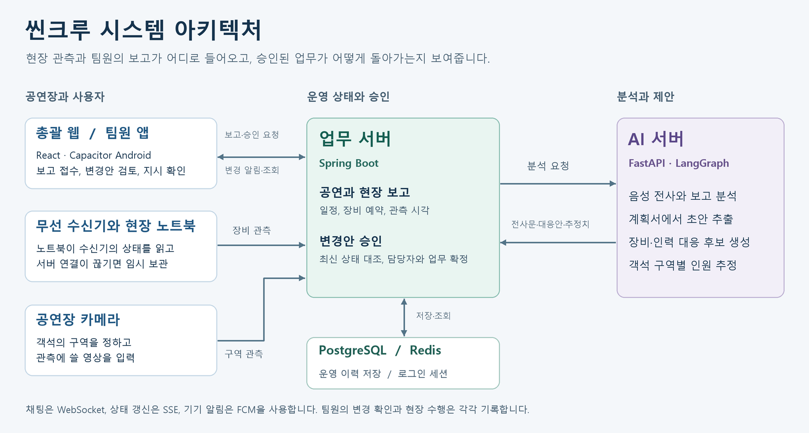

총괄 웹과 팀원 앱은 같은 업무 서버를 사용합니다. 웹은 공연 전체와 변경 전후의 비교에, 앱은 지금 할 일과 보고·확인에 집중했습니다. 현장 노트북은 공연장의 무선 수신기를 읽고, 카메라는 객석의 지정 구역을 관측합니다. 업무 서버에는 장비 관측과 현장 보고가 각각 들어옵니다. 총괄은 두 정보의 시각과 출처를 보고 대응을 시작합니다.

구조도의 화살표는 서비스 사이의 논리적 흐름입니다. 카메라 관측은 AI 서버의 구역별 인원 추정을 거쳐 판단 근거가 되고, 음성·보고 분석과 대응 후보도 업무 서버로 돌아옵니다. **AI 서버는 분석과 후보 생성을, 업무 서버는 현재 계획·예약 대조와 승인 결과 저장을 맡습니다.** 총괄이 승인하면 업무 서버의 변경이 담당자 앱에 전달되고, 팀원은 변경 확인과 현장 수행을 각각 기록합니다. 장비나 카메라의 관측값만으로 담당자가 자동 교체되지는 않습니다.

11월 18일 보강 전 회고에 있던 간략 구조도

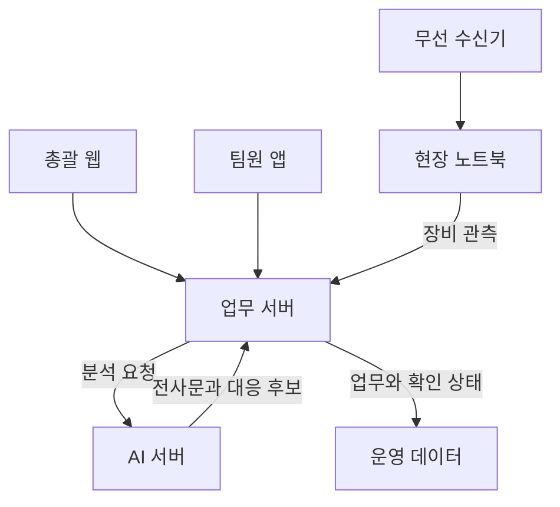

기존 간략도는 카메라 입력과 승인 후 팀원에게 돌아가는 경로를 생략하고 있었습니다. 위 PNG에서는 관측·분석·승인의 역할과 사용자에게 돌아오는 흐름을 함께 표시했습니다.

| 구성 | 맡은 일 | 이 구성이 필요했던 이유 |
| --- | --- | --- |
| 웹과 Android | 하나의 React 프로젝트에서 화면과 API 연결을 공유하고 앱 자산을 APK에 동봉 | 같은 변경을 총괄은 승인 대기 목록에서, 팀원은 내 업무에서 봅니다. 앱 화면이 바뀌면 새 APK로 업데이트해야 하므로 웹 배포일과 앱 배포일을 따로 관리했습니다. |
| 업무 서버와 저장소 | 공연 계획, 일정, 장비 예약, 보고, 변경 승인과 확인을 PostgreSQL에 기록하고 Redis를 함께 사용 | 어느 팀원이 먼저 알림을 열었든, 다시 접속하면 서버에 저장된 최신 담당자와 업무를 확인할 수 있게 했습니다. |
| AI 처리 | 별도 서버에서 음성을 전사하고 보고를 분석합니다. 대응안은 인력·일정 등 관련 역할에 작업을 나눠 맡기고 검토한 뒤 총괄에게 돌려줍니다. | 보조 마이크를 찾는 일과 그 마이크를 가져올 사람을 찾는 일은 서로 다른 조건을 봅니다. 최종 적용은 업무 서버가 현재 공연 상태와 대조합니다. |
| 현장 수집과 전달 | 수신기는 현장 노트북이 읽고, 카메라 영상은 관측 구역별 인원 추정에 씁니다. 채팅에는 WebSocket, 상태 갱신에는 SSE, 기기 알림에는 FCM을 사용하도록 구성했습니다. | 장비 관측이 끊겨도 팀원이 직접 본 상황을 보고할 수 있습니다. 화면에는 관측 시각과 마지막으로 확인한 사람이 남습니다. |

확정된 계획에 남아 있는 미배정 업무 묶음은 최초 한 번 자동 배정할 수 있습니다. 공연 중 담당자나 예약이 달라지는 변경은 총괄 승인을 거칩니다.

**변경안 두 개가 같은 계획에서 출발한 경우**가 승인 설계를 가장 잘 설명합니다. 첫 번째 승인으로 담당자나 장비 예약이 바뀌면, 두 번째 안의 미리보기는 이미 과거 상태입니다. 이 경우 최신 상태로 다시 비교해야 합니다. 한편 팀원이 변경 안내를 봤다는 사실만으로 장비가 설치됐다고 처리하면, 총괄은 실제 공연을 시작해도 되는지 판단할 수 없습니다. 그래서 알림 열람, 업무 변경 확인, 현장 수행을 별도로 기록했습니다.

11월 6일에는 시험 행사에서 화면을 연 뒤 확인 대상을 바꿔 보았습니다. 오래된 대상에 대한 확인은 서버에서 거절됐고 화면이 최신 정보를 다시 읽었습니다. 새 대상을 확인하자 확인 시각은 저장됐고, 업무는 수행 전 대기 상태를 유지했습니다. 11월 12일 운영 서버에서는 AI가 담당자를 제시하지 못하거나 공연 운영 시간 밖의 조치를 제안해 처음 두 요청이 실패했습니다. 수정 후에는 대응안이 생성됐고 총괄 화면에서 인력·안내·검토 등 각 역할의 처리 결과를 확인했습니다.

## 기술 스택과 선택 이유

| 영역 | 선택 | 이유 |
| --- | --- | --- |
| 웹·Android | React 19, TypeScript 6, Vite 8, TanStack Query. Android는 Capacitor 8(최소 SDK 24, 대상 SDK 36) | 하나의 프로젝트에서 총괄 웹과 팀원 앱의 화면과 API 연결을 공유합니다. 앱에는 빌드한 화면을 동봉해 APK 단위로 버전을 추적합니다. |
| 업무 서버 | Java 21, Spring Boot 4.1.1, Flyway | 공연 계획, 승인, 권한, 원자 저장을 맡는 서버입니다. 스키마는 마이그레이션으로 관리하고 빈 DB와 기존 DB 양쪽에서 적용을 시험합니다. |
| 저장소 | PostgreSQL 17(pgvector), Redis, RabbitMQ, Neo4j | 현재 업무 사실과 권한의 기준은 PostgreSQL입니다. Neo4j는 영향 분석용 사본으로 두고, 새 기능 때문에 그래프 DB나 특정 계산 라이브러리를 필수로 도입하지 않았습니다. |
| 실시간 전달 | WebSocket(채팅), SSE(상태 갱신), FCM(기기 알림) | 전달 목적이 다른 세 경로를 나눴습니다. 알림 내용은 서버에 저장하므로 어느 경로로 먼저 받든 다시 접속하면 최신 상태를 읽습니다. |
| AI 서버 | FastAPI, LangGraph | 대응안 생성은 Supervisor와 전문 Agent의 실행 흐름(병렬 위임, 충돌 시 재위임, 허용 도구)을 그래프로 표현합니다. |
| 음성 전사 | faster-whisper large-v3, CPU int8 | 구역과 물품 이름을 정확히 받아써야 합니다. 76문장 비교에서 소음 환경의 이름 인식률이 small 54.1%에서 large-v3 82.6%로, 문장 완전 일치가 7.9%에서 56.6%로 올랐습니다. 깨끗한 음성의 이름 인식률은 90.8%에서 99.1%였습니다. |
| 보고 분석 | klue/roberta-base 기반 분류·이름 추출 모델, ONNX INT8 | PyTorch 원본과 정확도 차이가 0.005~0.017로 작았고, 로컬 CPU 한 스레드에서 짧은 보고는 46.8ms에서 11.6ms로, 상주 메모리는 1,153MiB에서 526MiB로 줄었습니다. 배포 모델은 평가 분할 200건에서 유형 macro F1 0.958, 상태 macro F1 0.969, 개체 F1 0.902였습니다. |
| 계획·배정·대응안 | GPT-4o 계열(GMS 경유)과 규칙 기반 대체 경로 | 언어 모델은 해석과 후보 구성을 맡고, 시간·호환·겹침은 서버의 결정적 계산이 검증합니다. 배정에는 모델을 쓸 수 없을 때를 위한 규칙 기반 경로를 따로 두었습니다. |
| 객석 밀집도 | 구역 지정 밀도 합산(DM-Count 후보 비교) | 카메라 영상에서 구역별 추정 인원과 밀집도를 얻고, 관측 시각과 범위를 함께 보여줍니다. |
| 배포·운영 | Docker Compose, Jenkins, nginx, Prometheus·Grafana | 시험 통과를 배포 조건으로 두고, 컨테이너별 메모리 상한과 자원 경보를 함께 운영합니다. |

## 설계 심화

### 모든 업무 데이터는 공연 아래에 묶입니다

운영 DB는 PostgreSQL 17(pgvector 포함)에 45개 테이블, 89개 인덱스, 108개 외래키로 구성됩니다. 외래키 108개 중 31개가 공연(`event`)을, 25개가 참여자(`member`)를 가리킵니다. 보고, 업무, 장비 예약, 카메라 관측, 변경안, 알림이 모두 한 공연과 한 참여자에 매달려 있어서 공연이 끝나면 한 단위로 정리할 수 있고, 다른 공연의 데이터를 읽는 경로가 구조상 생기지 않습니다.

| 영역 | 테이블 수 | 대표 테이블 |
| --- | --- | --- |
| 계정·기기 | 4 | 계정, 소셜 로그인 연동, 기기 토큰, 앱 설치 |
| 공연 계획 | 10 | 공연, 프로그램, 구역, 직무 그룹, 참여자, 업무, 평면도, 입력 문서, 미확정 초안 |
| 보고·AI 작업 | 6 | 상황(issue), 보고, 음성 파일, 운영 상황, 의존 관계, AI 작업 |
| 변경·승인 | 5 | 변경안, 근거 revision, 담당자 확인, 복구 시뮬레이션, 운영 로그 |
| 장비 | 11 | 장비 자산, 수집기, 수신기·포트 연결, 장비 관측(최신값 분리), 필요 조건, 예약 |
| 안전 | 3 | 안전 카메라, 구역별 관측, 구역 위험 기준 프로필 |
| 알림·채팅 | 3 | 알림, 알림 전달, 채팅 메시지 |
| 전달 신뢰성 | 2 | 멱등 기록, 발행 대기 이벤트(outbox) |

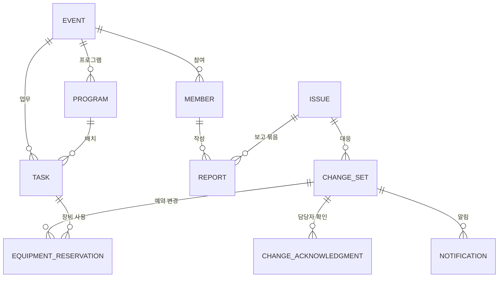

위 관계는 11월 18일 기준 스키마의 외래키에서 추렸습니다. 같은 변경안이 예약, 담당자 확인, 알림에 모두 연결되기 때문에 승인 한 번이 어디까지 영향을 주는지 한 번에 추적할 수 있습니다.

### 승인 한 번은 하나의 저장으로 끝납니다

변경안을 적용할 때 서버는 다음을 같은 흐름에서 확인합니다.

1. 요청자가 해당 공연의 현재 총괄인지, 공연이 모집 중이거나 진행 중인지 확인합니다.
2. 화면이 보고 있던 변경안의 revision과 미리보기 해시, 공연의 revision이 현재와 같은지 확인합니다.
3. 변경안이 건드리는 담당자, 업무, 장비 예약이 실제로 존재하고 서로 충돌하지 않는지 확인합니다.
4. 통과하면 업무·프로그램·그룹·안내 변경, 공연 revision 증가, 변경안의 적용 상태, 운영 로그, 본인 대상 확인 항목, 알림과 outbox 이벤트, 멱등 기록을 한 번에 저장합니다. 승인과 적용을 나눈 별도 요청으로 처리하지 않습니다.

이미 성공한 같은 요청은 새로 적용하지 않고 기존 결과를 돌려줍니다. 같은 키에 다른 본문이 오면 충돌로 거절합니다. 미리보기 해시는 화면이 본 내용을 식별하는 값일 뿐이어서, 검사와 저장 사이의 경쟁은 DB 잠금과 버전 검사가 따로 막습니다. 운영 DB에는 이 요청을 식별하는 멱등 기록이 387건, 발행 대기 이벤트가 313건 쌓여 있습니다.

승인과 실행은 한 단계 더 분리했습니다. 알림 열람, 업무 변경 확인, 현장 수행을 각각 따로 기록하고, 장비를 실제로 인수·설치했다는 사실은 담당자가 직접 남깁니다. 계획에서 배정됐다는 이유나 알림을 확인했다는 이유만으로 복구가 끝났다고 판단하지 않습니다.

### 권한은 모든 경로에 같은 순서로 적용됩니다

검사 순서는 계정과 세션, 현재 참여자, 공연 상태, 총괄·팀원 구분, 본인·소속 관계입니다. 이 검사를 화면과 API뿐 아니라 AI에 넘기는 입력, 집계, 실시간 구독, 파일 조회에도 똑같이 적용합니다.

| 동작 | 총괄 | 팀원 |
| --- | --- | --- |
| 변경안 작성·승인, 복구 대안 계산 | 가능 | 불가 |
| 업무 상세·수행 | 전체 조회, 수행은 본인 것만 | 본인에게 배정된 업무만 |
| 장비 현황·예약 시간표 조회 | 가능 | 조회가 허용된 그룹의 현재 참여자만 |
| 안전 지도, 구역별 관측, 지원 후보 | 가능 | 불가. 본인 업무 구역의 최소 집계만 |
| 카메라 웹 연결 | 가능 | 연결 담당 업무를 맡은 동안만. 프레임마다 현재 참여와 담당을 다시 검사 |
| 안전 인력 이동, 장비 예약 변경 적용 | 총괄 승인 | 불가 |

그룹은 소속을 나누는 평면 분류이고 승인권이 없습니다. 담당이 해제되거나 그룹을 옮기면 현재 자격을 다시 검사해서 이전 접근을 회수합니다. 카메라 관측만으로 상황(issue)을 자동 생성하지 않고, 사람이 보고한 내용과 대조합니다.

### AI는 후보를 만들고, 서버가 검증합니다

대응안 생성은 Supervisor 한 개와 전문 Agent 다섯 개(계획, 일정, 인력, 안내, 검토)가 나눠 맡습니다. Supervisor는 일정과 인력 검토처럼 서로 의존하지 않는 분석을 병렬로 위임하고, 두 결과가 충돌하면 충돌한 부분만 한 번 다시 위임합니다. 검토 Agent는 제안을 독립적으로 다시 확인합니다.

- 역할마다 쓸 수 있는 도구 목록이 정해져 있고, 목록 밖 도구를 부르면 그 Agent는 실패합니다.
- 인력 Agent는 같은 그룹의 활성 참여자와 현재 업무량, 시간 충돌만 조회합니다. 현재 담당자를 자동으로 교체하지 못합니다.
- AI는 DB를 직접 고치거나 승인 사실을 만들지 못합니다. AI가 낸 후보는 서버가 현재 공연 상태와 다시 대조한 뒤에만 반영됩니다.
- 호환성, 점유 시간, 인력, 원래 구역 유지 같은 항목은 언어 모델이 아니라 서버의 결정적 계산으로 검증합니다.

운영 서버의 개발·리허설 기간(11월 13~17일) 기록에서 변경안 생성은 23건 중 9건이 성공했고, 11건은 검토 단계에서 후보를 통과시키지 않았으며, 3건은 AI 서비스를 쓸 수 없었습니다. 계획 생성은 23건 중 14건이 성공했고 9건이 검토 단계에서 걸러졌습니다. 걸러진 후보는 총괄에게 올라가지 않고 대응안을 만들지 않은 것으로 끝납니다.

## 내가 맡은 일

### 기획 변경을 구현까지 따라가기

3주 동안 기획을 아홉 차례 개정하면서, 화면과 서버가 서로 다른 버전의 기획을 기준으로 개발되는 문제가 생겼습니다. 저는 PDF로 관리하던 기획을 Markdown 본문으로 옮기고, 결정 이유와 영향을 받는 화면·서버·AI 기능을 연결했습니다. 과거 버전은 보관하고 다음 개정 때 처리할 불일치를 기록했습니다. 팀원이 제안한 내용은 문답을 거쳐 채택한 뒤 개발 기준에 반영했습니다. 각 기능의 결정, 구현, 시험 결과를 나눠 기록해 PM이 다음 확인을 누구에게 요청할지도 알 수 있게 했습니다.

프로젝트의 기본 MR 리뷰어로서 이슈 담당, 리뷰, 병합의 기준도 정리했습니다. 같은 기능에서 에이전트가 작업하더라도 담당자가 실제 결과를 확인하도록 했습니다. 이 경험은 [Agent & Harness 학습 노트](../agent&harness/README.md)에도 정리했습니다.

### 웹·앱 공통 기반과 PDF에서 시작한 공연의 장비 복구

처음에 정한 플랫폼 기준 세 가지는 공연 운영 기능을 추가할 때도 계속 사용했습니다.

| 결정 | 이유 |
| --- | --- |
| 같은 웹 기술로 총괄 화면과 Android 앱을 만들고, 앱에는 빌드한 화면을 동봉 | 공통 기능을 함께 수정할 수 있고, 휴대폰에 설치한 화면의 버전을 APK 단위로 추적할 수 있습니다. |
| 로그인과 화면 이동은 웹·Android에 맞게 처리 | 브라우저에서 공연 링크를 여는 경우와, 외부 로그인을 마친 뒤 휴대폰 앱으로 돌아오는 경우의 이동 경로가 다릅니다. |
| 서버 데이터 조회와 업무를 바꾸는 요청의 재시도 방식을 구분 | 목록은 다시 읽어도 되지만, 보고·승인은 응답을 잃은 시점에 이미 처리됐을 수 있습니다. |

보고를 전송한 직후 네트워크가 끊기면, 사용자는 서버가 보고를 받았는지 알기 어렵습니다. 같은 버튼을 다시 눌러 보고가 두 건 쌓이면 현장에서는 장애도 두 건처럼 보입니다. 저는 웹과 앱의 요청 처리 계층을 공통화해 같은 요청을 재전송할 때 기존 요청 번호와 내용을 유지했습니다. 결과가 불명확하면 현재 상태를 다시 읽고, 사용자가 작성하던 보고와 녹음은 뒤로 가기 전에 확인하도록 했습니다. Android에서는 로그인 뒤 앱 복귀를 실기기로 확인했고, 웹에서는 알림함에서 변경을 확인한 결과가 서버에 저장되는지 검증했습니다.

후반에는 PDF를 올려 만든 공연에서도 장비 복구가 이어지는지 살폈습니다. 계획서의 장비가 화면에 보여도, 공연 중 어느 마이크와 수신기를 함께 쓰며 교체 시간에 무엇이 예약돼 있는지 서버가 알아야 후보를 계산할 수 있습니다. 저는 추출한 일정표·평면도·장비를 입력 화면과 공개 과정에 연결하고, 장비 운영 백엔드에서 마이크와 수신기의 관계를 복구 계산에 반영했습니다. 후보를 검토할 때는 호환성, 예약 충돌, 이동·설치·재시험 시간 중 무엇이 확인됐고 무엇을 사람이 확인해야 하는지 표시하도록 했습니다. 11월 17일에는 웹으로 연결한 카메라의 관측도 안전 인력 지원의 판단 근거로 받도록 수정했습니다.

### 실제 수신기에서 읽을 수 있는 것

제가 연결한 장비는 Shure QLXD4 무선 마이크 수신기입니다. 현장 노트북에서 송신기 연결 여부, 배터리, 무선 신호와 음량 상태를 수집하고 업무 서버로 전송했습니다. 실제 송신기의 전원을 껐을 때 수신기에서 송신기 종류를 더 이상 식별할 수 없다는 변화를 확인했습니다. 이때 화면에 필요한 정보는 마지막 관측 시각과 무엇이 달라졌는지입니다. 전원이 꺼진 이유나 객석에서 소리가 들리는지는 현장 팀원의 보고로 보완했습니다.

초기에는 수집 중 현장 노트북의 유선 연결이 끊긴 뒤 일부 시험에서 수신기의 네트워크 통신이 복귀하지 않았습니다. 조건을 나눠 반복하자 수집 연결의 유무에 따라 결과가 달랐습니다. 수신기 내부 원인을 파고드는 대신, 재현으로 확인한 조건에 맞춰 수집기가 장비를 다시 발견하는 방식과 공연 중 케이블 고정 절차를 정비했습니다. 이후 시험도 **노트북과 장비 사이의 단절**과 **수집 중 업무 서버의 중단**을 구분했습니다. 두 장애는 복구 방법도, 잃을 수 있는 데이터도 다릅니다.

### 수집이 끊겼을 때의 검증

11월 6일에는 실제 수신기와 노트북을 연결하고, 저장된 관측의 일련번호를 대조했습니다.

| 시험 조건 | 결과 | 여기서 내린 판단 |
| --- | --- | --- |
| 로컬 서버에 수신기 2대의 관측을 30분 전송 | 각 10,637건과 10,633건 저장. 두 수신기 모두 번호 누락·중복 0건 | 서로 다른 수신기의 관측을 동시에 구분해 저장할 수 있었습니다. |
| 운영 서버에 수신기 1대의 관측을 30분 전송 | 10,658건 저장. 번호 누락·중복 0건. **수집부터 서버 저장까지 중앙값 921ms, 최대 2.23초** | 시험용 공연·장비에서 운영 서버를 포함한 수집 경로를 확인했습니다. 화면 반영이나 장비 복구까지 걸린 시간은 이 측정에 포함하지 않습니다. |
| 150초 수집 시험 중 로컬 서버가 23초간 응답하지 않음 | 중단 중 기록을 노트북에 쌓고 복구 뒤 다시 전송. **시험 전체 875건** 저장 | 짧은 중단에서 재전송과 저장을 끝까지 확인했습니다. |
| 21분 수집 시험 중 처음 17분간 로컬 서버 중단 | 미전송 보관 한도 5,000건을 넘어 오래된 **1,410건 유실**. 당시에는 버려진 건수가 기록에 남지 않음 | 수집기 경고·종료 요약과 서버 로그에 유실량을 남기도록 수정했습니다. 보관 한도는 여전히 있으므로 장시간 장애 후에는 손실 여부를 확인해야 합니다. |

실기 연속 수집은 30분을 기준으로 마쳤습니다. 시뮬레이터와 기록 재생은 같은 입력으로 판독 동작을 반복 점검하는 데 사용했습니다.
보관 기한은 로컬 시험 기록 22,145건의 만료 시각을 앞당기고 정리 주기를 10초로 줄여 재현했습니다. 주기 계측 22,086건은 24시간, 상태 변화 59건은 30일 보관으로 분류됐고, 각 만료 조건에서 삭제됐습니다. 최신 값 41건은 공연 진행 중에는 유지되고 종료 후 삭제됐습니다. 만료 시각을 앞당긴 이 재현으로 24시간·30일 보관 분류와 삭제 시점을 확인했습니다.

위 수치는 11월 6일 실기 시험 기록을 대조한 결과입니다.

## AI 평가에서 선택이 바뀐 지점

### 소음 제거보다 먼저 확인했던 것

콘서트용 음성 보고에서는 “메인 마이크”와 “예비 마이크”를 구분하는 일이 중요했습니다. 팀은 행사 보고 107문장을 합성 음성으로 만들고 음악·환호·웅성거림을 섞어 전사 결과를 비교했습니다. 평가에 사용한 범용 소음 제거를 먼저 적용하면 글자 오류율이 오히려 높아지거나 이득이 작았습니다. 최종적으로 원음에 공연의 구역명과 곡 이름 같은 문맥을 힌트로 주는 방식을 택했습니다.

같은 혼합 소음 조건(신호 대 잡음비 5dB)에서 **글자 오류율은 기본 힌트 15.4%, 공연 힌트 8.3%로 7.1%p 낮아졌습니다.** 휴대폰 실기에서는 녹음한 말이 운영 서버에서 전사돼 앱의 보고 입력 칸으로 돌아왔습니다. 무음이라는 뜻은 남았지만 마이크 이름 일부를 다르게 받아쓴 사례도 있었습니다. 팀원이 문장을 읽고 장비명을 고친 뒤 보고하는 절차를 둔 이유입니다.

### 보고 분석과 객석 추정

| 팀에서 평가한 대상 | 관찰 결과 | 제품에서 내린 판단 |
| --- | --- | --- |
| **보고 유형과 문장 안의 이름 추출** | 팀이 만든 콘서트 보고 107문장을 두 묶음으로 나누고, 학습에 쓰지 않은 묶음에서 번갈아 평가했습니다. 추가 학습 후 보고 유형별 F1의 평균은 0.717 → 0.865, 구역·장비 등 이름의 시작과 끝을 정확히 짚었는지 평가한 개체 F1은 0.723 → 0.844였습니다. | 11월 11일 운영 AI 서버의 실제 보고 응답에서 새 모델 사용을 확인했습니다. 최종 배포 모델은 107문장 전부로 학습했습니다. 위 점수는 교차 평가 결과입니다. 운영 서버에서 보고 분석 작업은 12건이 성공했고, 작업 생성부터 종료까지 중앙값 0.62초, 95번째 백분위 1.12초였습니다. |
| **구역별 추정 인원** | 전시장 로비 CCTV 한 대의 13장을 이용해 구역별로 정답 인원과 비교했습니다. 가까운 대기 줄에서는 DM-Count 후보의 평균 절대 오차가 약 2.3명이었고, 먼 뒤편에서는 모든 후보가 크게 과소 추정했습니다. | 구역을 화면에 지정해 밀도를 합산하고 관측 범위와 촬영 시각을 함께 보여줍니다. 원거리를 심하게 적게 세는 구역은 관측 대상에서 빼도록 했습니다. 시연 영상에서는 카메라의 구역 관측이 인력 지원 승인으로 이어지는 흐름을 보여줍니다. 위 오차는 전시장 로비 CCTV 13장 기준입니다. |

음성과 군중 모델의 학습·평가는 AI 담당 팀원의 작업입니다. 저는 현장 팀원이 전사문을 확인하는 화면, 총괄이 관측 품질과 지원 후보를 보는 흐름, 웹 카메라 관측과 지원 판단의 연결을 담당했습니다.

## 실서버·실기기에서 확인한 범위

- **프론트엔드 회귀 시험.** 11월 4일 음성 보고 연동 당시 FE 시험 37개 파일의 486건이 통과했고 웹·Android용 자산 빌드도 성공했습니다. 아래 실서버 기록은 그 뒤 실제 연결에서 확인한 결과입니다.
- **웹과 Android.** 11월 6일 화면과 업무 서버 사이에서 알림함 조회 및 변경 확인을 검증했고, 11월 11일에는 Android 기기에서 소셜 로그인 후 앱으로 복귀하는 경로를 확인했습니다. 0.5.0은 시연 휴대폰 설치 기록이 있고 0.7.0은 11월 13일 공개 배포 기록이 있습니다.
- **카메라.** 11월 11일 실제 웹캠을 연결해 운영 웹에 현재 영상과 촬영·수신 시각이 표시되는 것을 확인했습니다. 이후 웹에서 연결한 카메라의 관측을 지원 후보 판단까지 이어 붙였습니다. 시연 영상에서는 안전요원이 앱에서 승인된 업무를 확인하고 A구역으로 이동합니다.
- **업무 서버.** 11월 13일 팀 QA 보고서에서는 당시 집계한 HTTP 접점 125개 중 119개에 요청과 응답을 직접 검증한 기록이 있고 6개는 당시 MVP 범위에서 제외했습니다. 핵심 통합 시험은 실제 HTTP, 권한 검사, PostgreSQL, Redis를 거쳤습니다. 자동 배정과 변경안 생성의 AI 응답, 기기 푸시 발송은 해당 시험에서 대역으로 처리했습니다.
- **공연 종료.** 공연 종료와 일회 요약 생성, 웹의 요약 조회 버튼, 복사 동작에 대한 구현과 시험 기록을 확인했습니다. 시연 영상은 마이크 교체와 객석 지원을 중심으로 구성했습니다.

### 운영 서버 실측 (2026-11-19 09:11 KST 조회)

운영 서버를 읽기 전용으로 조회했습니다. DB의 행사 16개는 모두 시험·검증·쇼케이스 공연이며 실사용자 데이터는 없습니다. 아래 수치는 개발·촬영 기간 동안 쌓인 기록입니다.

| 항목 | 실측 |
| --- | --- |
| 서버 | Ubuntu 24.04, 4 vCPU·16GiB 메모리(스왑 4GiB), 연속 가동 28일, 메모리 사용 약 4.1GiB |
| 컨테이너 | 14개 동시 가동, 재시작 0회. 서비스 7개(nginx, frontend, backend, PostgreSQL 17+pgvector, Neo4j, Redis, RabbitMQ), Jenkins, 모니터링 6개 |
| 데이터베이스 | 테이블 45개, 인덱스 89개, 외래키 108개. 마이그레이션 20개를 10월 27일~11월 17일에 적용했고 실패 0건 |
| 배포 | Jenkins 배포 작업 60회 중 58회 성공(96.7%) |
| 11월 17일 촬영일 | 보고 5건, 변경 승인·적용 2건, 담당자 확인 2건, AI 작업 92건, 객석 관측 수신 18:07까지 |
| 누적 기록 | 업무(task) 140건, AI 작업 155건, 객석 관측 556건, 장비 관측 269건, 음성 파일 58건 |

AI 작업의 처리 시간은 업무 서버가 작업을 만든 시각부터 끝난 시각까지이며, 성공한 건만 집계했습니다.

| 작업 | 성공 건수 | 중앙값 | 95번째 백분위 |
| --- | --- | --- | --- |
| 음성 전사 (faster-whisper large-v3 int8) | 57 | 9.97초 | 11.34초 |
| 보고 분석 (ONNX int8 모델) | 12 | 0.62초 | 1.12초 |
| 변경안 생성 | 9 | 2.08초 | 7.21초 |
| 계획 생성 | 14 | 11.96초 | 24.69초 |
| 초기 업무 배정 | 13 | 2.48초 | 3.02초 |
| 공연 입력 추출 | 16 | 1.68초 | 2.24초 |
| 복구 시뮬레이션 | 7 | 0.00초 | 0.00초 |

## 인프라와 배포

업무 서버는 Docker Compose로 운영합니다. 외부에 열린 포트는 HTTP·HTTPS 두 개이고, DB·Redis·메시지 큐는 컨테이너 내부 네트워크로만 연결합니다. 방화벽(UFW)은 켜 둔 상태입니다. nginx는 일반 API, WebSocket 업그레이드(채팅), SSE 스트림(상태 갱신), 헬스체크 경로를 나눠 프록시하고, 헬스체크 외의 관리 경로는 열지 않습니다.

| 구성 | 내용 |
| --- | --- |
| 자동 배포 | Jenkins가 develop 브랜치를 2분마다 확인합니다. 새 커밋이 있으면 백엔드 시험을 먼저 실행하고, 시험이 실패하면 배포 단계로 넘어가지 않습니다. 동시 빌드는 막고 30분 안에 끝나지 않으면 중단합니다. |
| 배포 실적 | 60회 중 58회 성공 |
| 메모리 상한 | 서비스마다 상한을 둡니다. 백엔드 3GiB, PostgreSQL 3GiB, Neo4j 2GiB, RabbitMQ 1GiB, Redis 768MiB, 상한 합계는 약 13GiB입니다. 서버 전체 사용량은 약 4.1GiB입니다. |
| 모니터링 | Prometheus(지표 15일 보관), Alertmanager, Grafana, cAdvisor, node-exporter, Uptime Kuma. 운영 도구 포트는 서버 안에서만 열리고 SSH 터널로 접속합니다. |
| 백업 | 암호화한 백업을 정기적으로 만들어 서버와 S3에 둡니다. 10월 22일부터 989개를 만들었고 파일 하나는 약 1.1MB입니다. |
| 인증서 | 도메인 인증서를 발급하고 webroot 방식으로 자동 갱신합니다. |

AI 서버는 업무 서버와 분리한 별도 인스턴스(4 vCPU·16GiB, CPU 전용)이고, 업무 서버의 주소만 허용합니다. 운영 시점에는 보고 분석(ONNX int8), 음성 전사, 계획, 배정, 대응안, 입력 추출, 요약, 군중 밀집도의 AI 앱 여덟 개가 이 서버에서 돌았습니다.

## 품질과 검증

2026년 11월 19일에 개발 브랜치 최신 상태에서 시험을 다시 실행했습니다. 백엔드는 Docker 위의 PostgreSQL 17과 Redis를 Testcontainers로 띄워 실제 DB 경계까지 통과시켰고, AI 모듈은 Linux 컨테이너에서 실행했습니다.

| 영역 | 시험 | 결과 |
| --- | --- | --- |
| 백엔드 | JUnit 통합·단위 시험(실제 HTTP, Spring Security, PostgreSQL, Redis) | 132개 클래스, **1,499건 통과** |
| 프론트엔드 | Vitest 단위 시험 | 92개 파일, **1,007건 통과** |
| 프론트엔드 | TypeScript 타입 검사, ESLint | 오류·경고 0건 |
| 장비 수집기 | pytest(프로토콜 해석, 재전송, 저장 규칙, 웹 연결) | **70건 통과** |
| AI 서버 | 계획 207, 배정 26, 대응안 85, 요약 10, 군중 14, 보고 분석 15, 보고 API 48, 런타임 19, 음성 전사 97 | **521건 통과** |
| 합계 | | **3,097건 통과** |

AI 배정 시험은 입력의 기준 시각을 2026년 11월 18일로 맞춰 실행했고, 음성 전사의 프로세스 수명 시험 1건은 컨테이너 환경에서 제외했습니다. 프론트엔드에는 사용자 시나리오를 따라가는 Playwright 시험이 30개 파일, 198개 시나리오로 작성돼 있습니다.

공개 API는 11월 13일 팀 QA에서 HTTP 접점 125개 중 119개에 요청과 응답을 직접 검증했고, 나머지 6개는 MVP 범위에서 제외했습니다. 코드의 접점 수(조회 44, 생성 52, 수정 15, 교체 5, 삭제 9)도 125개로 같습니다. 마이그레이션은 11월 13일 QA에서 빈 DB에 처음부터 적용하는 경로(V1→V18)와 이전 버전 DB에 이어 적용하는 경로(V12→V18)를 모두 시험했습니다.

## 프로젝트 규모

| 항목 | 규모 |
| --- | --- |
| 개발 기간 | 2026년 10월 13일 ~ 11월 18일 (37일) |
| 커밋 | 1,569개 (병합 489개 포함). 병합을 제외하면 11월 4일(98개)과 11월 10일(95개)에 가장 많았습니다. |
| 소스 | 백엔드 약 7.5만 줄, 프론트엔드 약 7.5만 줄, AI 약 2.6만 줄, 장비 수집기 약 0.4만 줄. Java·TypeScript·Python·SQL·YAML을 시험 코드까지 합산했고 합계는 약 17.9만 줄입니다. |
| 파일 | Java 579, TypeScript 288, TSX 162, Python 137 |
| 공개 API | 접점 125개 |
| DB | 테이블 45, 인덱스 89, 외래키 108, 마이그레이션 20 |
| AI | 서비스 8종. 음성 전사 모델, 보고 분석 모델, GPT-4o 계열의 계획·배정·대응안 생성, 규칙 기반 입력 추출, 군중 밀집도 추정 |
| 기획 | v3.0에서 v9.0까지 9차례 개정, 10월 20일부터 Markdown으로 관리 |
| 시험 | 3,097건 통과 |

## 기여 범위와 집계 기준

통합 개발 브랜치의 11월 17일 이력에서 병합 커밋을 제외해 세었습니다. 제 두 작성자 표기를 합쳐 **전체 1,078개 중 459개**입니다. 한 커밋이 여러 폴더를 바꾸면 각 폴더에 한 번씩 잡히므로 아래 행을 더해 전체 기여를 구하지 않습니다. 리뷰와 병합도 이 수치에서는 제외했습니다.

| 영역 | 내 작성 커밋 / 해당 영역 전체 | 실제 맡은 일 |
| --- | --- | --- |
| 프론트엔드 | 219 / 294 | 웹·앱 공통 기반, 서버 응답 연결, 현장 보고·장비·안전 화면과 실기기 검증. UI/UX 담당자와 협업 |
| 장비 수집 | 16 / 16 | 수신기 발견·판독, 수집과 재전송, 복수 수신기 연결, 실기 검증 |
| 백엔드 | 61 / 368 | 장비 상태와 예약 조건, 교체 후보 계산, PDF로 준비한 공연의 장비 복구, 웹 카메라 관측 반영 |
| 문서 | 229 / 378 | 기획 개정, 결정 기록, 기능 사이 불일치 추적, 검증 결과 정리 |
| AI / 인프라 | 각각 27 / 151, 3 / 44 | PDF 추출 결과와 계획 입력의 연결 등 담당 기능에 필요한 변경. 모델 학습·평가와 운영 인프라는 각 담당 팀원이 주도 |

## 대표 문제 해결

### 1. 같은 계획에서 출발한 변경안 두 개가 모두 승인되는 상황

- **문제.** 변경안 A와 B가 같은 상태에서 만들어졌습니다. A를 승인하면 담당자나 예약이 바뀌므로, B의 미리보기는 이미 과거 상태입니다.
- **판단.** 총괄이 본 화면과 적용되는 결과가 달라지면 안 됩니다. 변경안마다 기준 revision과 미리보기 해시를 두고, 적용 시점의 공연 revision과 맞지 않으면 거절해서 최신 상태로 다시 비교하게 했습니다.
- **결과.** 11월 6일 시험 행사에서 화면을 연 뒤 확인 대상을 바꿔 보았습니다. 오래된 대상에 대한 확인은 서버가 거절했고 화면이 최신 정보를 다시 읽었습니다.

### 2. 보고를 보낸 직후 네트워크가 끊길 때

- **문제.** 서버가 보고를 받았는지 알 수 없어 사용자가 버튼을 다시 누르면, 현장에는 장애가 두 건처럼 보입니다.
- **판단.** 웹과 앱의 요청 처리 계층을 공통화하고, 업무를 바꾸는 요청은 재전송할 때 기존 요청 번호와 내용을 그대로 유지하게 했습니다. 서버는 같은 요청 번호의 이전 결과를 돌려줍니다. 목록 조회처럼 다시 읽어도 되는 요청과는 재시도 방식을 구분했습니다.
- **결과.** 운영 DB에는 멱등 기록 387건이 쌓였고, 작성하던 보고와 녹음은 화면을 떠나기 전에 확인하도록 했습니다.

### 3. 수집 중 노트북의 유선 연결이 끊긴 뒤 수신기가 돌아오지 않을 때

- **문제.** 초기 시험에서 일부 경우 수신기의 네트워크 통신이 복귀하지 않았습니다.
- **판단.** 수집 연결의 유무로 조건을 나눠 반복하고, 노트북과 장비 사이의 단절과 수집 중 업무 서버의 중단을 서로 다른 장애로 구분했습니다. 두 장애는 복구 방법과 잃을 수 있는 데이터가 다릅니다.
- **결과.** 수집기가 장비를 다시 발견하는 방식과 공연 중 케이블 고정 절차를 정비했습니다. 실제 수신기로 30분을 연속 수집해 서버 저장 10,658건에서 번호 누락과 중복이 0건이었고, 수집부터 서버 저장까지 중앙값 921ms, 최대 2.23초였습니다.

### 4. 서버가 오래 멈췄을 때 수집 기록이 얼마나 사라지는가

- **문제.** 21분 수집 중 처음 17분 동안 로컬 서버를 멈추자, 노트북의 미전송 보관 한도 5,000건을 넘어 오래된 1,410건이 사라졌고 당시에는 버려진 건수가 기록에 남지 않았습니다.
- **판단.** 정상 수집만 시험해서는 보이지 않던 요구사항입니다. 유실량을 운영자가 알아야 합니다.
- **결과.** 수집기의 경고와 종료 요약, 서버 로그에 유실량을 남기도록 수정했습니다. 23초 중단 시험에서는 중단 중 기록이 노트북에 쌓였다가 복구 뒤 모두 다시 전송됐습니다.

### 5. AI 후보를 어디까지 믿을 것인가

- **문제.** 11월 12일 운영 서버에서 처음 두 요청이 실패했습니다. AI가 담당자를 제시하지 못하거나 공연 운영 시간 밖의 조치를 제안했습니다.
- **판단.** 형식만 맞는 결과를 실행 가능한 대응안으로 표시하면 안 됩니다. 검토 Agent와 계약 검사, 서버의 현재 상태 대조를 통과하지 못한 후보는 대응안으로 만들지 않기로 했습니다.
- **결과.** 수정 후 운영 서버에서 대응안이 생성되고 총괄 화면에서 인력, 안내, 검토 각 역할의 처리 결과를 확인했습니다. 이후 11월 13~17일 기록에서 변경안 생성 23건 중 11건과 계획 생성 23건 중 9건이 검토 단계에서 걸러졌고, 걸러진 후보는 총괄 화면에 올라오지 않았습니다.

## 설계 경계: 하지 않기로 한 것

씬크루는 기능을 더하는 만큼 하지 않을 일도 정했고, 이 경계를 화면과 서버 검사에 같이 반영했습니다.

| 하지 않는 일 | 이유와 대신 하는 일 |
| --- | --- |
| 관측값이나 시뮬레이션만으로 상황 생성, 인력 이동, 계획 변경을 자동 적용 | 카메라 추정이나 장비 관측은 사람이 보고한 내용과 대조하는 근거입니다. 변경은 총괄의 승인을 거칩니다. |
| 모델의 분류 점수만으로 공식 상황을 만들거나 합치기 | 분류 결과는 문장 해석입니다. 위험도 판정이 아니며, 총괄이 출처와 근거를 보고 확인하거나 정정합니다. |
| 증상만으로 장비 고장 원인을 확정 | 믹서 장애가 확인된 상황에서는 같은 믹서를 쓰는 예비 마이크로 교체해도 출력이 복구되지 않으므로, 교체만 추천하지 않습니다. |
| 대안이 없을 때 성공 문구 표시 | 필요한 조건과 사람이 직접 대응하는 경로를 돌려줍니다. |
| 알림 확인이나 계획상 배정을 실제 수행으로 처리 | 알림 열람, 변경 확인, 현장 수행을 각각 기록합니다. |
| 사람 팀장, 계층 구조, 그룹별 승인권 | 권한은 총괄과 팀원 두 가지이고 운영 현황 화면의 트리는 조직도가 아닙니다. |
| 카메라 영상 녹화·저장 | 연결 화면에 "녹화/저장하지 않습니다"를 명시합니다. 지도의 점은 개인 위치가 아니라 추정 인원입니다. |
| 종료 요약 원문 서버 보관 | 요약은 한 번 만들어 복사하거나 로컬에 저장합니다. 서버에는 생성 시도만 기록합니다. |
| 과거 계획 전체 복제, 별도 예비 풀, 필수 AI 채팅 메뉴 추가 | 현재 상태와 최소한의 근거를 유지하는 쪽으로 범위를 줄였습니다. |

## 배운 점

**장비를 연결할 때는 정상 수집과 장애 후 복구를 따로 시험하게 됐습니다.** 30분간 데이터가 빠짐없이 쌓이는 것을 보고도, 서버가 오래 멈췄을 때 무엇이 사라졌는지는 알 수 없었습니다. 보관 한도를 넘겨 본 뒤에야 누락량을 운영자가 볼 수 있어야 한다는 요구사항이 나왔습니다.

**모델을 고르는 기준도 운영자의 다음 행동에서 찾았습니다.** 멀리 있는 군중을 적게 세면 총괄에게는 한산한 구역처럼 보입니다. 마이크 이름 한 글자가 틀리면 다른 장비의 교체 업무가 될 수 있습니다. 그래서 정확도 수치와 함께 사람이 어디서 오류를 발견하고 바로잡을지를 설계했습니다.

**공연 중에는 승인 뒤의 한 단계가 더 필요했습니다.** 총괄 화면에 교체 업무가 생겨도 무대에서는 여전히 소리가 나지 않습니다. 시연 영상이 승인 화면에서 끝나지 않고 담당자의 전달과 공연 재개까지 한 장면으로 이어지게 구성한 이유입니다. 다음에도 현장 업무를 설계할 때는 요청한 사람의 화면과 함께, 실제로 움직일 사람이 무엇을 보고 어떻게 완료를 알리는지 확인하겠습니다.
