# 씬크루 (SceneCrew)

## 한 줄 소개

콘서트 총괄과 현장 운영 인력이 공연 계획, 직무별 업무, 음향 장비, 관객 안전, 현장 보고를 **같은 운영 사실**로 보고 조정하도록 돕는 WEB/Android 서비스입니다. AI는 계획 초안과 대응안을 **제안만** 하고, 실제 변경은 사람 총괄이 승인해야 반영됩니다. SSAFY 15기 자율 프로젝트(A202)입니다.

> 이 문서는 **2026-11-04 `develop` 기준 진행 중 기록**입니다. 실제 시연은 2026-11-18이며, 시연이 끝나면 결과와 최종 수치로 갱신합니다. SSAFY 규정상 소스 코드는 공개할 수 없으므로 코드 대신 문제 정의, 사용자 흐름, 구조와 의사결정, 검증 결과를 서술합니다. 화면 캡처는 앱에 내장된 **데모 모드(가상 인물·예시 데이터)**로 찍었습니다.

## 기본 정보

| 항목 | 내용 |
| --- | --- |
| 기간 | 2026-10-13 ~ 2026-11-18 (시연·종료 예정) |
| 형태 | SSAFY 15기 자율 프로젝트, 6인 팀 |
| 팀 구성 | 본인 + 팀원 5인 (INFRA·서버/배포, AI 모델·데이터, UI/UX, BE 인증·채팅·알림, BE 계획·이슈·AI 실행 연동) |
| 역할 | 기획·범위 관리와 정책 문답, FE 플랫폼·공통 구조·API 연동, 실제 음향 장비 연결·상태 수집, 모든 MR의 기본 리뷰어 |
| 주요 기술 | React 19·TypeScript·Vite·Capacitor Android / Java 21·Spring Boot·PostgreSQL·Redis / Python·FastAPI·LangGraph / WebSocket·SSE·FCM / Docker Compose·Nginx |
| 내 기여 | frontend 커밋 99개 중 86개, equipment 7개 전부, docs 235개 중 149개 (전체 483개 중 233개) |
| 상태 | 진행 중 (11/04 기준 시연용 APK 0.3.0 배포) |

## 문제 정의

### 처음 문제: 운영이 본업이 아닌 사람들의 행사

운동회를 준비하는 교사, MT 운영진, 발표회를 준비하는 팀처럼 운영이 본업이 아닌 사람들은 계획서는 만들어도 **당일 현장에서 무슨 일이 생겼을 때 누구를 어디로 보내야 하는지** 판단하기 어렵습니다. 업무가 엑셀·단톡방·구두 지시로 흩어져 있어서, 변경이 생기면 "누가 알고 있고, 누가 실제로 움직였는지"를 확인할 방법이 없습니다.

### 바뀐 문제: 콘서트 현장 (v9, 2026-11-02)

시연 2주 전, 범용 행사에서 **콘서트 운영**으로 대상을 좁히고 네 가지를 더했습니다.

| 추가한 것 | 풀려는 문제 |
| --- | --- |
| 장비 복구 대안 계산 | 메인 마이크가 꺼졌을 때 예비 장비·담당자·이동 시간·예약 충돌을 따져 실제로 가능한 복구안을 고르기 |
| 고정 카메라 기반 구역별 안전 지원 | 특정 객석 구역에 관객이 몰릴 때, 다른 구역의 최소 인원을 지키면서 지원 인력을 보내기 |
| 소음 제거 STT | 음악이 울리는 현장에서도 음성 보고를 문장으로 받기 |
| 운영 상황 유형화 | 장비 이상·일정 지연·인력 공백·관객 안전 같은 상황마다 가능한 대응과 "판단 불가" 조건을 미리 정의 |

## 기획의 진화: 3주 동안 아홉 번의 개정

이 프로젝트에서 가장 많이 한 일은 **기획을 고치고, 고친 기획이 코드·계약과 어긋나지 않게 맞추는 일**이었습니다.

| 시점 | 버전 | 무엇이 바뀌었나 |
| --- | --- | --- |
| 10/13 ~ 10/20 | v3.0 ~ v4.1 | PDF 기획서로 시작. 버전마다 PDF를 다시 만들면서 문서 사이 불일치가 쌓임 |
| 10/20 | (전환) | **기획 관리를 Markdown으로 전환.** 과거 PDF는 `history/`에 원본 그대로 보관하고, 문서 간 불일치 목록을 만듦 |
| 10/22 | v5.0 | BE 범위 조정에 맞춘 전면 개정 |
| 10/23 | v5.9 → v6.0 | 대상(비전문 운영자)·권한(총괄 직속, 사람 팀장 제거)·종료 출력 축소. 정밀 검수 후 v6.0 확정 |
| 10/24 ~ 10/26 | v7.0 | 백엔드·음성 분석 기준 정렬. 기획을 "검토안"에서 **개발 기준**으로 전환 |
| 10/27 | v8.0 | 통합 개정. 10/28 실제 시연일 11/18 확정 |
| 11/02 | v9.0 | **콘서트 운영으로 전환**, 장비·안전·소음·상황 유형 통합 |

축소할 때도 기준을 세웠습니다. 10/23 범위 축소 검토의 결론은 "사람 조직·관리 기능과 과거 전체 상태 보관은 줄이고, **현재 업무 상태·보고·총괄 승인·실행 검증은 줄이지 않는다**"였습니다. 테이블 수를 줄이려고 행을 JSON 컬럼에 밀어 넣는 식의 축소는 하지 않았습니다.

## 사용자 흐름

권한은 **총괄(CHIEF)과 팀원(WORKER) 두 가지**뿐입니다. 사람 팀장이나 계층은 두지 않고, 팀원은 직무 그룹(관객 안전, 무대영상, 음향·장비 등)에 참여합니다. 하루 운영 팀은 최대 31명입니다.

```text
준비       총괄이 공연 조건·PDF를 확인해 AI 계획 후보를 검토·수정·확정
  ↓
참여·배정  팀원이 초대 링크로 직무 그룹에 참여 → 확정된 미배정 업무 묶음만 AI가 최초 자동 배정
  ↓
현장 대응  팀원이 텍스트·고정 문구·음성으로 보고 → AI가 상황별로 분석해 대응안 제안
           → 총괄이 변경 전후를 비교해 승인 → 바뀐 담당자가 앱에서 본인 확인 → 실제 수행 기록
  ↓
종료       종료 요약을 한 번 생성해 복사·로컬 저장 (서버에는 생성문을 보관하지 않음)
```

## 서비스 화면 (데모 모드)

> 모든 화면은 데모 모드의 가상 인물·예시 데이터입니다.

### 운영 현황 (WEB, 총괄)

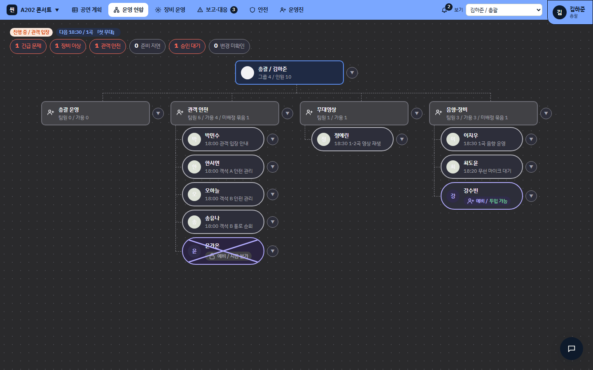
*상단에 긴급 문제·장비 이상·관객 안전·승인 대기·변경 미확인 수를 모으고, 그룹별로 누가 지금 어떤 업무를 하는지 보여준다. 예비 인원과 투입 불가 인원도 구분한다.*

### 공연 계획

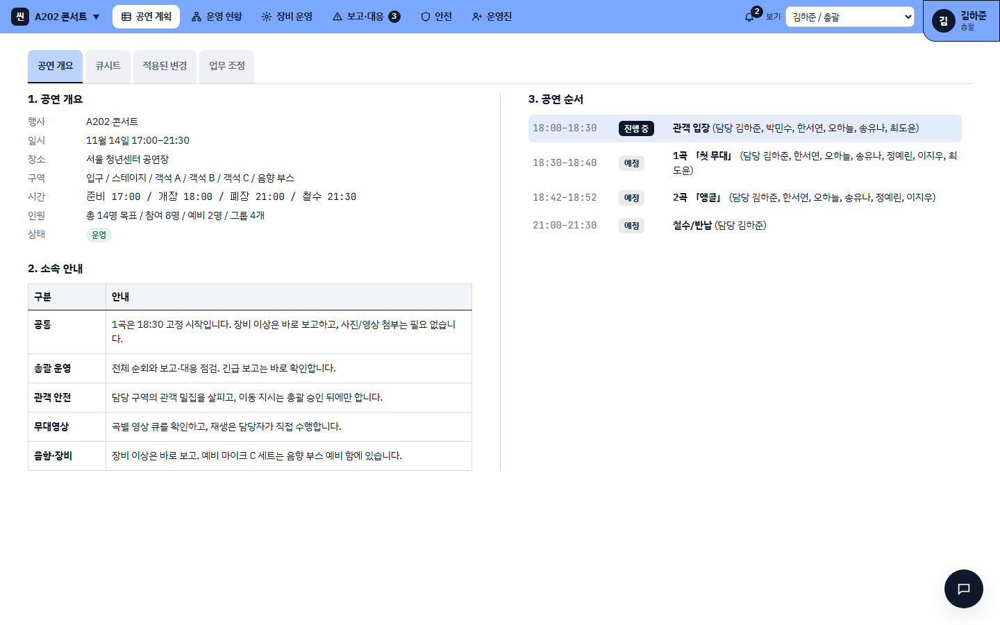

### 장비 운영

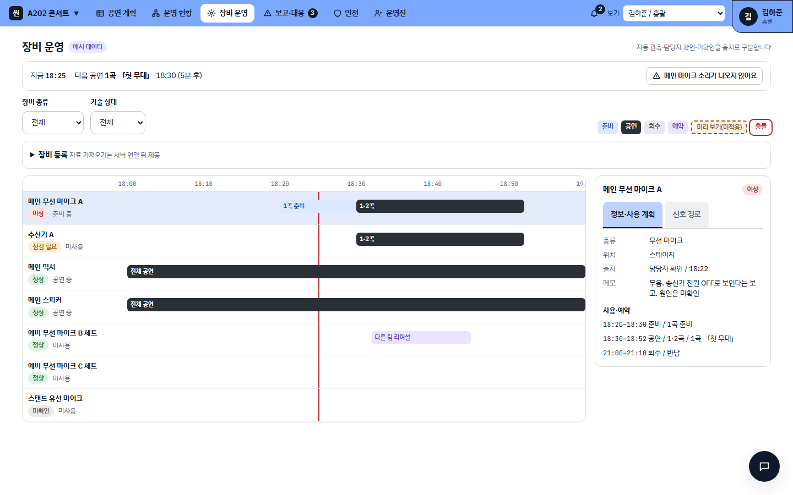
*장비마다 곡별 사용 시간과 예약을 시간표로 보여준다. 상태 옆에 "담당자 확인 / 18:22"처럼 **출처와 시각**을 같이 표시해, 자동 관측·담당자 확인·미확인을 구분한다.*

### 보고 접수와 AI 대응안

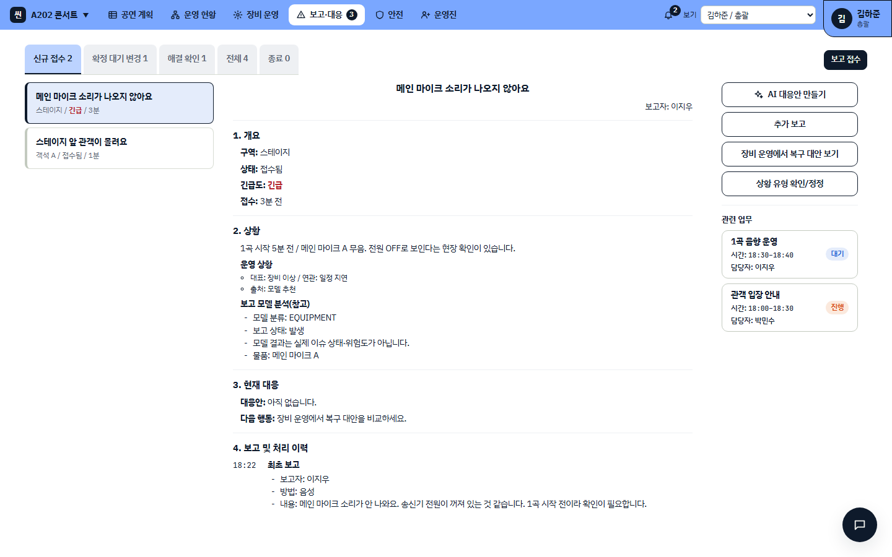
*보고 모델의 분류(EQUIPMENT 등)는 "참고"로만 표시하고, 모델 결과가 실제 이슈 상태나 위험도가 아니라는 점을 화면에 적었다.*

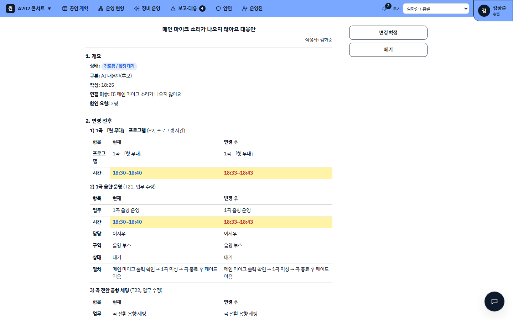
*AI 대응안은 "후보"다. 바뀌는 업무마다 현재와 변경 후를 나란히 비교하고, 총괄이 "변경 확정"을 눌러야 반영된다. 캡처에는 위쪽만 담았지만, 대응안 끝의 "확인 필요 사항"에는 "확정 전에는 예약·배정이 실제 인수·설치 기록이 아니다", "알림 읽음은 업무 시작 확인이 아니다" 같은 주의가 들어간다.*

### 안전

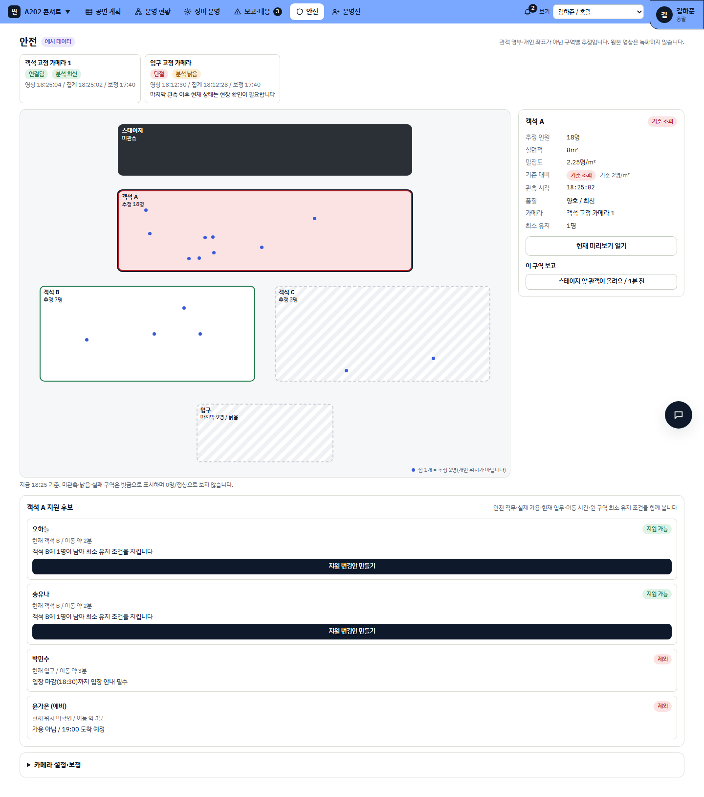
*점 하나는 개인 위치가 아니라 **추정 2명**이다. 관측하지 못했거나 오래된 구역은 빗금으로 표시하고 0명·정상으로 보지 않는다. 지원 후보는 원래 구역에 최소 인원이 남는지까지 확인해 "지원 가능 / 제외"로 나눈다.*

### 팀원 앱 (Android)

| 현황 | 내 업무 | 상황 보고 | 음성 보고 |
| --- | --- | --- | --- |
| 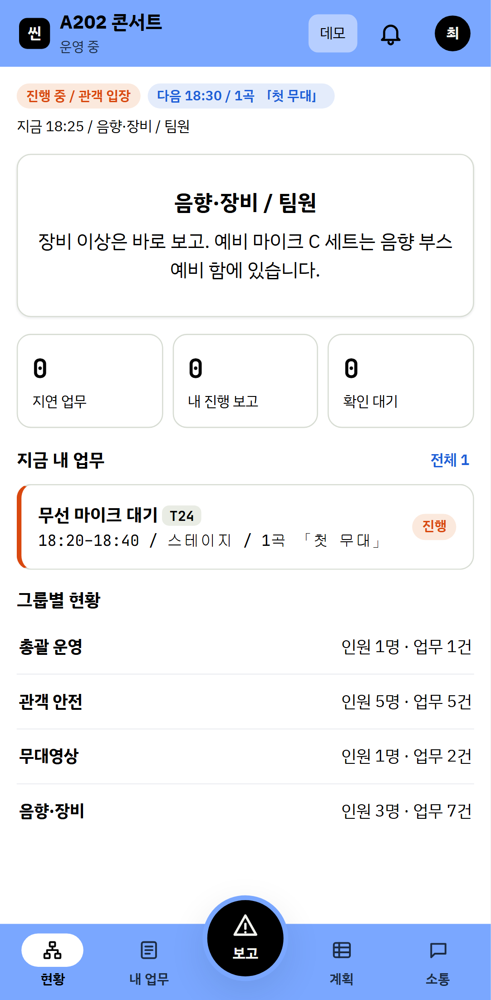 | 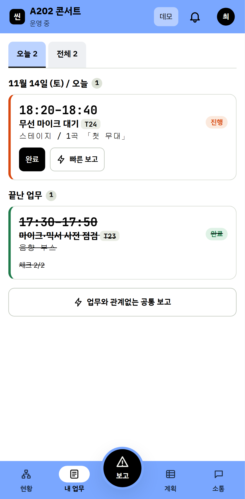 | 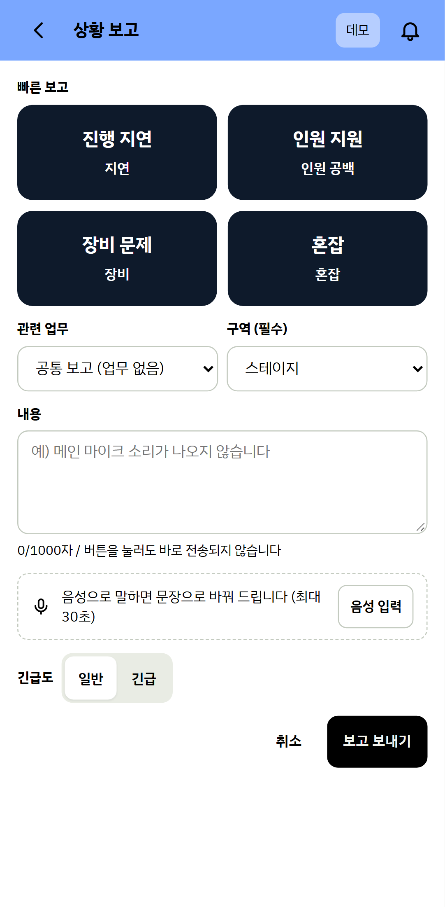 | 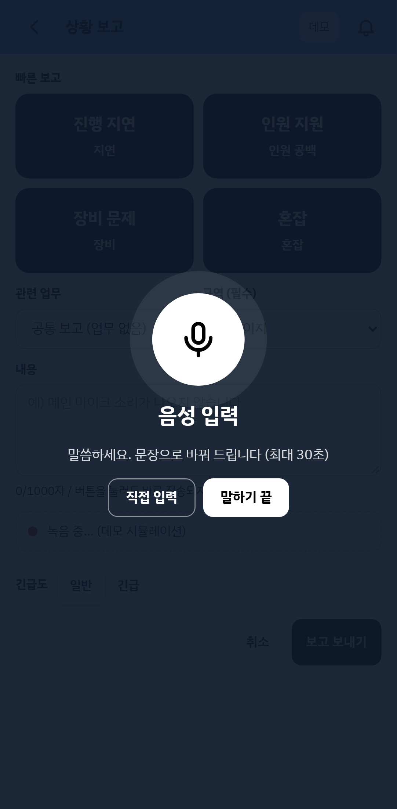 |

*팀원 앱은 현황·내 업무·계획·소통 4탭과 가운데 보고 버튼으로 구성했다. 음성은 문장으로 바뀐 뒤 **본인이 확인하고 고쳐서** 보내야 정식 보고가 된다.*

## 시스템 구조

> 이 섹션과 다음 섹션은 **팀 전체의 설계**입니다. 업무 서버는 BE 팀원 2인, AI 서버와 모델은 AI 팀원, 인프라는 INFRA 팀원 담당이고, 본인은 기획 단계에서 아래 원칙을 문서로 정리하고 팀원과의 문답으로 확정하는 역할을 했습니다. 본인이 직접 구현한 부분은 [내 담당 상세](#내-담당-상세)에 따로 적었습니다.

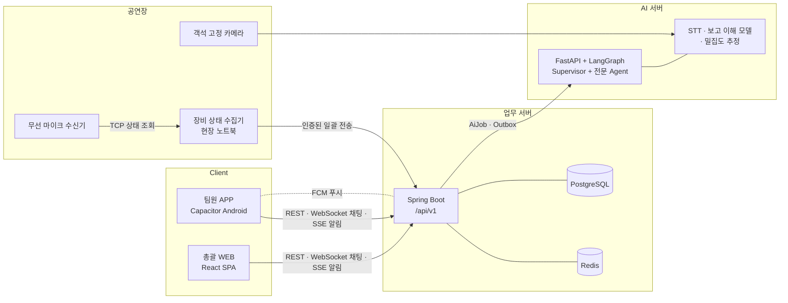

각 항목이 2026-11-04 `develop`에서 어디까지 와 있는지 함께 표시했습니다. **설계 확정**은 기획·계약에 정해졌다는 뜻이고 동작한다는 뜻이 아닙니다.

| 구성 | 설계 | 11/04 상태 |
| --- | --- | --- |
| 서버 분리와 AI Job | 업무 서버와 AI 서버를 분리하고, AI 처리는 Job으로 접수한다. 접수 기록을 먼저 DB에 남기고 따로 전달하는 Outbox 방식이라 AI가 늦거나 죽어도 수동 계획·보고·대응은 계속된다 | BE에 Job·Outbox 처리 코드 있음, 공개 API는 아직 인증 위주 |
| 실시간 | 채팅은 WebSocket, 알림과 Job 진행은 SSE(서버가 보내는 단방향 스트림), 앱이 꺼져 있을 때는 FCM 푸시. 끊기면 저장된 상태를 다시 조회해 복구 | FE 연결 코드와 가짜 서버 시험 있음, BE 서버 쪽은 `develop`에 아직 없음 |
| 장비 연결 | 브라우저나 클라우드 서버는 장비에 직접 접속하지 않고, 현장 노트북의 수집기만 수신기와 통신 | 수집기 실기 확인, 업무 서버 수신 API는 미정 |
| AI Agent | Supervisor가 Planning·Schedule·Staffing·Guide·Review 전문 Agent를 도구처럼 골라 위임. 각 Agent는 같은 행사·현재 권한 범위의 **읽기와 결정적 계산 도구만** 쓰고, DB 변경이나 승인은 못 함 | 설계 확정, `develop`에는 계획 생성 계약과 보고 이해 모델 API만 있음 |
| 데이터 | 37개 테이블, 387개 필드, 외래키 90개, 논리 HTTP API 80개 | 테이블은 마이그레이션으로 생성됨, API는 단계적으로 공개 중 |

## 핵심 설계 판단

### AI는 제안하고, 사람이 승인하고, 서버가 검증한다

AI 대응안은 담당·시간·내용 변경과 예비 인력 투입을 **총괄 승인 후에만** 반영합니다. 승인할 때 서버는 현재 사실, 제안 버전, 미리보기 해시(총괄이 본 변경 전후 내용의 지문)를 다시 확인해, 그사이 상황이 바뀌었으면 적용하지 않습니다. 확인되면 업무·예약·담당·알림을 한 번에 적용합니다. 예외는 "확정된 계획의 미배정 업무 묶음을 처음 연결하는 일" 하나뿐입니다. 시간 겹침, 장비 호환, 원 구역 최소 인원 같은 조건은 LLM이 아니라 **조회·계산 도구**로 확인합니다.
*상태: 기획 확정. BE에 승인 변경(ChangeSet) 처리 코드가 있고, FE 화면은 데모와 계약 시험으로 확인.*

### "알림을 받았다", "확인했다", "실제로 했다"는 다른 사실이다

운영 현장에서 가장 흔한 사고는 "공지했으니 다들 알겠지"입니다. 그래서 채팅 수신, 영속 알림함, 기기 푸시, **본인의 공식 변경 확인**, **실제 수행(인수·설치·이동·재시험·도착)**을 각각 따로 기록합니다. 알림을 읽은 것을 업무 시작으로 세지 않습니다.
*상태: 기획 확정, FE 화면 반영(데모·계약 시험 기준).*

### 관측만으로 자동 조치하지 않는다

카메라 밀집도나 장비 자동 관측은 **판단 근거**일 뿐입니다. 관측이나 시뮬레이션만으로 공식 이슈를 만들거나 인력을 옮기거나 계획을 바꾸지 않습니다. 카메라 원본은 녹화하지 않고 프레임은 처리 후 폐기하며, 집계만 30일 보관하기로 했습니다.
*상태: 기획 확정. 카메라·관측 테이블은 생성됨, 프레임 처리와 보관 기한은 구현 전.*

### 모름과 0을 구분한다

장비 수신 실패, 오류 코드, 판독 불가, 무음을 "0%"나 "정상"으로 바꾸지 않습니다. 안전 화면에서도 관측하지 못한 구역은 0명이 아니라 빗금으로 표시합니다.
*상태: 장비 수집기(본인 구현)와 FE 안전 화면에 반영.*

## 내 담당 상세

### 1. 기획 문서 운영 체계

여섯 명이 동시에 개발하면서 기획이 3주 동안 아홉 번 바뀌었습니다. 기획이 바뀔 때마다 코드·API 계약·화면이 어긋나지 않게 하려고 문서를 **코드처럼** 관리했습니다.

- **Markdown 전환 (10/20)**: PDF와 변환본을 편집하던 방식을 버리고 Markdown 본문을 직접 편집했습니다. 현재 기획은 제품 8개, IA 6개, BE 14개, AI 문서 등 65개 파일(약 1만 줄)입니다.
- **결정 기록**: 팀원과 문답으로 정한 정책을 `V9-D12`처럼 버전별 번호를 붙여 기록하고(40여 건), 본문·변경 이력·관련 미결 항목을 함께 갱신했습니다. "제안"을 "합의"로 표시하지 않는다는 규칙을 지켰습니다.
- **불일치 대장**: 문서끼리, 문서와 코드가 어긋나는 지점을 `C-`/`GAP-` 번호로 관리했습니다(48건 추적).
- **검증 스크립트**: 기획 문서의 버전 메타데이터, 내부 링크, 미결 ID, 인용을 검사하는 스크립트로 개정할 때마다 확인했습니다.
- **정밀 감사 (10/28)**: 저장소 472개 파일 중 387개(82%)를 기획·코드·계약과 대조해 감사했고, 지적 사항을 코드와 화면에 반영했습니다.

### 2. FE 플랫폼과 API 연동

React 프로젝트 하나로 총괄 WEB과 팀원 Android 앱을 함께 만들었습니다.

| 결정 | 선택과 이유 |
| --- | --- |
| 구성 | React + Vite 단일 프로젝트 + Capacitor Android. 인원·일정상 계정·업무·UI를 한 lockfile로 관리 |
| 앱 배포 방식 | 웹 URL을 WebView로 원격 로드하지 않고 빌드 자산을 APK에 동봉. 서버 변경이 앱에 바로 반영되는 대신 APK와 자산 버전이 어긋나는 문제를 피함 |
| 라우팅 | WEB은 BrowserRouter, Android는 HashRouter |
| 서버 상태 | TanStack Query. **명령(쓰기)은 자동 재시도 금지**, 오프라인 보류 후 재연결 자동 실행도 막음 |
| 플랫폼 판별 | 빌드 모드와 실제 네이티브 여부로만 판별. 화면 너비나 User-Agent로 관리자 권한을 정하지 않음 |
| 인증 | WEB은 같은 출처 쿠키 + CSRF, Android는 쿠키 없이 Access 토큰. 전송 계층을 채널별로 주입 |

- **공통 API 소비 어댑터**: 오류 본문, 실패 분류, 401 이후 세션 복구를 한 번에 하나만 수행하는 게이트, 멱등 키(같은 요청을 여러 번 보내도 한 번만 처리되게 붙이는 요청 번호) 관리를 공통 계층에 모았습니다. 특히 응답을 잃은 명령은 **같은 키·같은 본문으로만** 다시 보내고, 결과가 불명확하거나 서버에서 만료됐으면 자동으로 새 키를 만들지 않고 상태 조회로 돌립니다. 같은 보고가 두 번 접수되거나 같은 변경이 두 번 적용되는 것을 막기 위해서입니다.
- **이탈 보호와 Android Back 우선순위**: 작성 중인 보고나 녹음 중에 뒤로 가면 확인 창 → 모달 닫기 → 미저장 확인 → 이전 화면 → 앱 최소화 순서로 처리하는 공통 기반을 만들었습니다.
- **연결한 기능 (11/02 ~ 11/04)**: 실제 인증과 초대 참여, 계획 생성 Job 상태, 장비 현황·등록·관계, 장비 이상의 복구 대안 비교와 변경안 생성, 보고·대응안 승인·변경 확인, 안전 지도와 카메라 현재 프레임, 전체·그룹 채팅의 실시간 연결과 메시지 복구, 알림 스트림과 알림함, 음성 보고(녹음 → 전사 접수 → 전사문 채우기), Android 푸시 기기 등록, 공연 종료와 일회 요약.
  - 이 연결은 **계약 시험과 가짜 서버 응답 기준**입니다. 실제 서버와의 끝까지 연동은 BE 공개 API가 배포되는 대로 확인합니다(11/02 기록 기준 실서버에서 확인한 것은 상태 확인과 미인증 응답뿐).
- **API 계약 대응**: BE 팀원이 정리한 공개 API 계약안(기존 80개 중 67개 선택, 13개 제외)이 아직 병합 전이었지만, 이 계약안을 먼저 기준으로 수용하기로 결정하고 기획 문서와 FE 소비 계층을 거기에 맞춰 재배치했습니다. 새 장비·안전 API는 이 계약을 건드리지 않는 별도 확장으로 분리해, FE·BE가 같은 기준으로 개발하게 했습니다.
- **실기기와 배포**: 시연 기기(Galaxy S10, Android 12)에서 Debug APK 설치·기동·재시작·Back·회전을 직접 확인한 뒤, 승인된 Release 키로 서명한 시연용 APK 0.2.0(11/03)과 0.3.0(11/04)을 만들어 팀원에게 배포했습니다. 기기 설치 확인과 업데이트 설치까지 기록했습니다.

### 3. 실제 음향 장비 연결: 무선 마이크 수신기 상태 수집기

시연의 첫 장면이 "공연 직전 메인 마이크가 꺼졌다"는 장비 이상입니다. 이를 담당자 보고만이 아니라 **실제 장비 상태**로도 확인하려고, Shure QLXD4 무선 마이크 수신기에 직접 연결하는 수집 프로그램을 만들었습니다.

| 구성 | 역할 |
| --- | --- |
| 장비 찾기 | 수신기가 주기적으로 보내는 SLP 멀티캐스트 알림(같은 네트워크의 장비가 "나 여기 있다"고 알리는 방송)을 **듣기만** 해서 주소를 찾음. 네트워크 대역을 탐색하지 않음 |
| 프로토콜 | TCP 문자열 메시지의 분할·결합·쓰레기 바이트 처리, 판독 규칙(오류 코드, UNKN, 범위, 단위) |
| 수집 루프 | 계측 스트림(500ms) 수집, 끊기면 0.5초부터 최대 10초까지 늘려 재접속, 10초 이상 데이터가 없으면 반쯤 끊긴 연결로 보고 재접속 |
| 최신성 | 계측이 최신인지(FRESH/STALE/OFFLINE)를 소리 상태와 분리해서 판정 |
| 시뮬레이터 · 재생 | 가짜 수신기로 전원·발화·배터리·끊김·정지 상황을 재현하고, 실기 원문 기록을 다시 해석해 회귀 시험 |
| 기록 | `LIVE`/`SIMULATOR`/`REPLAY` 모드를 기록에 남겨, 시뮬레이터 결과를 실기 검증으로 세지 않음 |

지킨 원칙도 명확히 했습니다. 수신기의 주파수·게인·암호화·이름·전원을 바꾸는 명령은 보내지 않고 계측 간격만 설정합니다. 수신기 주소와 토큰은 기록과 저장소에 남기지 않습니다. 실행 의존성 없이 Python 표준 라이브러리만 쓰고, 시험(55개)에만 pytest를 씁니다.

**실기 결과 (11/03)**: 수신기 2대(직결)로 10분 연속 수집에서 해석 실패 0건, 계측 간격 중앙값 0.525초·최대 0.545초였고, 한 대는 1,139건을 끊김 없이 한 세션으로 받았습니다. 송신기 전원 변화와 발화(말할 때 오디오 레벨 7~22, 조용할 때 0)도 기록했습니다.

### 4. AI 에이전트와 함께 일하는 팀 규칙

팀원 모두 AI 코딩 에이전트를 쓰는 환경이라, 에이전트가 저장소에서 지켜야 할 규칙(`AGENTS.md`)을 정리했습니다. 작업 전 읽을 문서, Jira 이슈 상태 전환 조건(담당자가 실제 작업자이고 "해야 할 일"일 때만 "진행 중"으로, "완료"는 MR 병합으로만), MR 제목·본문·담당자·리뷰어·라벨 규칙, 커밋 메시지 형식, 팀원에게 보내는 글의 작성 틀을 담았습니다. 대회 규정에 맞춰 커밋·MR에 AI 도구 서명을 넣지 않는 규칙도 포함했습니다. 이 내용은 [Agent & Harness 노트](../agent&harness/README.md)와 이어집니다.

## 대표 문제 해결

### 1. 수집기를 연결한 채 케이블이 빠지면 수신기 네트워크가 멈췄다

**문제.** 실기 시험 중 노트북 쪽 LAN 케이블을 뽑았다 꽂자, 수신기가 어떤 신호에도 응답하지 않게 됐습니다. 다른 어댑터에 꽂아도 소용없었고 **수신기 전원을 껐다 켜야만** 복구됐습니다. 공연 중이라면 그 채널 음향이 끊기는 일입니다.

**조사.** 조건을 바꿔 가며 반복했습니다. 수집기가 연결되지 않은 상태에서는 3번 모두 정상 복귀했고, 연결이 열린 상태에서는 계측 방식·재접속 시점과 관계없이 9번 모두 멈췄습니다. 어댑터 절전 기능은 원인이 아니었습니다(절전 기능이 없는 어댑터에서도 멈춤). 패킷 캡처로 진행을 따라가 보니:

1. 케이블이 빠지는 순간 Windows는 연결을 끊는다는 신호(TCP RST)를 보내지만, 선이 빠져 있어 수신기에 닿지 않습니다. 수신기는 연결이 살아 있다고 보고 계측을 계속 쌓습니다.
2. 링크가 돌아오면 수신기는 주소를 다시 확인하고 알림을 재개합니다.
3. 약 40초 뒤 수신기가 쌓아 둔 계측 20여 개를 **옛 연결로** 한꺼번에 보내는데, 노트북은 방화벽 공용 프로필 때문에 응답 없이 버립니다.
4. 그 직후 수신기는 모든 송신을 멈춥니다.

덤으로, 수신기가 주소를 확인하는 도중에 노트북이 그 주소를 물으면 수신기가 충돌로 보고 **주소를 바꾸는** 현상도 찾았습니다. 그래서 수집기는 접속할 때마다 수신기의 알림을 들은 뒤에만 접속하도록 바꿨습니다.

**판단.** 방화벽 규칙이나 스위치를 추가하는 대책은 시연 환경에서 또 다른 미검증 변수를 만듭니다. 그래서 **"공연 중에는 노트북 쪽 케이블을 고정한다"**를 운영 결정으로 확정하고, 시연 구성을 시험과 같은 직결(어댑터 1개당 수신기 1대)로 고정했습니다. 확인하지 못한 가설(노트북이 RST로 응답하면 멈추지 않는지, 스위치가 있으면 어떤지, 펌웨어 결함인지)은 "확인하지 못한 것"으로 따로 남겼습니다.

### 2. 3주 동안 아홉 번 바뀐 기획을 코드와 어긋나지 않게 유지하기

**문제.** v4까지는 PDF로 기획서를 만들었는데, 버전이 바뀔 때마다 문서끼리 숫자와 용어가 어긋났고 어떤 문서가 최신인지 확인하기 어려웠습니다. 개발이 시작된 뒤에는 기획 변경이 BE의 ERD·API 계약, FE 화면, AI 계약에 각각 다른 속도로 반영됐습니다.

**해결.** Markdown 전환과 함께 "현재 기획은 하나, 과거는 원문 보관"을 원칙으로 삼았습니다. 개정할 때는 먼저 이전 버전 파일 목록과 해시를 보관하고, 결정은 번호를 붙여 근거와 함께 남기고, 어긋나는 지점은 불일치 대장으로 옮겼습니다. 모든 문서에 "기획에 채택", "코드 있음", "실행 확인", "리뷰 통과"를 구분해 쓰게 해서, 문서만 보고 "구현됐다"고 오해하지 않게 했습니다.

### 3. 응답을 잃은 명령을 어떻게 다시 보낼 것인가

**문제.** 현장 앱은 네트워크가 불안정합니다. "보고 보내기"나 "변경 확정"의 응답이 오지 않으면, 사용자는 다시 누르고 앱은 자동 재시도를 하기 쉽습니다. 그러면 같은 보고가 두 번 접수되거나 같은 변경이 두 번 적용될 수 있습니다.

**해결.** BE와 멱등 키 규칙을 맞추고 FE 공통 계층에서 강제했습니다. 명령은 자동 재시도하지 않고, 응답을 잃으면 **같은 키·같은 본문**으로만 재전송합니다. 서버가 "결과 불명"이나 "결과 만료"를 알려 주면 키를 보존한 채 상태 조회로 넘기고, 새 키로 새로 보내는 것은 사용자가 확인한 뒤에만 합니다. 종료 요약처럼 서버에 원문을 보관하지 않는 경우(410)도 같은 키로 다시 생성하지 않습니다. 이 규칙들을 계약 회귀 시험으로 고정했습니다.

### 4. 시연 2주 전의 방향 전환

**문제.** 11/02, 범용 행사 서비스에서 콘서트 운영으로 바꾸고 장비·안전·소음·상황 유형 네 기능을 더하기로 했습니다. 시연까지 16일이 남은 시점이었습니다.

**해결.** 새 기능을 처음부터 다시 설계하지 않고, 기존 구조(두 권한, 평면 그룹, 총괄 승인, 확인과 수행의 구분, 종료 요약 미보관)를 **그대로 유지한 채 확장**했습니다. 장비·안전을 새 사람 역할이나 별도 승인 엔진으로 만들지 않고 기존 Supervisor와 전문 Agent에 도구로 붙였습니다. 새 담당 분장과 주간 계획(11/02 ~ 11/08)을 함께 정리했고, 기존 기능(로그인·참여·보고·채팅·알림·요약)의 남은 작업도 주간 목록에 넣어 새 기능에 밀려 빠지지 않게 했습니다. 본인은 이 중 실제 장비 연결을 맡아 이틀 만에 실기 수집까지 확인했습니다.

## 품질과 검증

| 대상 | 결과 (11/04 기준) |
| --- | --- |
| FE 단위·계약 시험 | 37개 파일, 486개 통과 (Vitest) |
| FE 브라우저 시험 | Playwright 시나리오 파일 15개. WEB 데스크톱·작은 화면·Android 자산 세 환경으로 구성 (이번 기록에서는 실행 수 미집계) |
| 장비 수집기 | 55개 통과 (pytest), 실기 10분 연속 수집 해석 실패 0건 |
| 보고 이해 모델 (팀원 담당) | 평가 200건에서 유형 F1 0.942, 상태 F1 0.960, 개체 F1 0.903. 합성 데이터·개발 노트북 기준이며 목표 서버 측정 전 |
| 실기기 | 시연 기기에서 Debug·Release APK 설치·기동·업데이트 확인 |
| 기획 | 검증 스크립트 오류 0, 10/28 저장소 정밀 감사 |

모의 응답으로 통과한 시험을 실제 서버 연동으로 기록하지 않았습니다. 로그인 후 정상 응답, 실제 Job 처리 같은 실서버 검증은 BE 배포에 맞춰 따로 남겼습니다.

## 프로젝트 규모와 기여

| 항목 | 값 |
| --- | --- |
| frontend | 커밋 99개 중 86개 (FE 플랫폼·공통 구조·API 연동 주 담당, UI/UX 디자인은 팀원 담당) |
| equipment | 커밋 7개 전부 (장비 수집기 단독 구현) |
| docs | 커밋 235개 중 149개 (기획·결정·감사 기록. 작은 단위 커밋이 많아 커밋 수가 실제 분량보다 크게 보일 수 있음) |
| backend · ai · infra | 0/110 · 4/45 · 1/32 (팀원 담당 영역) |
| 전체 | 병합 제외 커밋 483개 중 233개 (약 48%) |
| MR 리뷰 | 기본 리뷰어로서 develop 대상 MR 병합의 절반 이상(84건)을 직접 병합 |
| FE 코드 | TypeScript 약 3.3만 줄 |
| 장비 수집기 | Python 약 2,900줄 |
| 기획 문서 | 현재 65개 파일 약 1만 줄 + 과거 9개 버전 보관 |

## 배운 점

### 실제 장비는 문서에 없는 방식으로 실패한다

공식 명령 문서만으로는 케이블 하나에 수신기가 멈추는 현상을 예측할 수 없었습니다. 시뮬레이터로 개발 속도를 높이되, 시뮬레이터 결과를 실기 검증으로 세지 않는 기록 방식이 중요했습니다. 원인을 끝까지 밝히지 못할 때는 **운영으로 막을 수 있는 결정**을 내리고, 모르는 것은 모른다고 남기는 것이 시연을 지키는 방법이었습니다.

### 늦은 방향 전환은 "무엇을 바꾸지 않을지"부터 정해야 한다

시연 2주 전 콘서트로 방향을 바꿀 수 있었던 것은 기능을 더하기 전에 유지할 원칙(두 권한, 총괄 승인, 확인과 수행의 구분)을 먼저 고정했기 때문입니다. 새 기능을 기존 구조의 도구로 붙이니, 범위가 넓어져도 기존 담당과 계약을 다시 짜지 않아도 됐습니다.

### AI를 넣을수록 사람의 승인 지점이 선명해야 한다

AI가 대응안을 만들 수 있게 되자 "어디까지 자동으로 해도 되는가"가 가장 중요한 질문이 됐습니다. 자동 예외를 하나로 줄이고, 계산은 도구로, 판단은 사람이 하게 나눈 것이 기능을 늘려도 흔들리지 않는 기준이 됐습니다.

## 시연까지 남은 과제 (11/04 기준)

- 수집기의 업무 서버 전송: 일괄 전송 코드는 있지만 수신 API가 아직 없어 BE와 계약 초안을 맞추는 중
- 믹서 USB 측정은 조건부 실험으로 아직 착수 전
- 로그인 후 정상 응답, 실제 Job 처리 등 FE 실서버 검증
- 카메라 입력·샘플링, 밀집도 추정의 최신성 기준과 현장 평가
- 보고 모델의 목표 서버 측정과 BE 연동
- 4분 ~ 4분 30초 대표 시연 리허설과 장면 길이 조정

## 비고

- 소스 코드, 서비스 주소, 서버·장비 주소, 서명 정보, 팀원 개인정보는 대회 규정과 보안상 싣지 않았습니다.
- 화면은 앱 내장 데모 모드에서 찍은 것으로, 실제 운영 데이터가 아닙니다.
- 수치는 2026-11-04 `develop` 기준이며 시연 후 갱신합니다.
